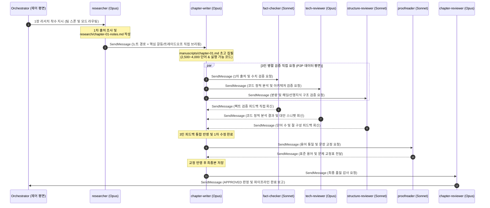
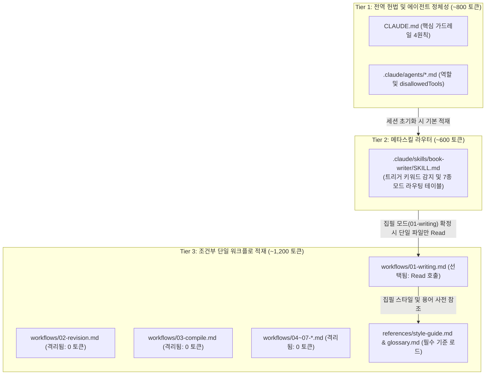

<!-- chapter: 01, title: "다중 에이전트 오케스트레이션 하네스와 최소 권한 설계", word_count: 3668, status: approved, author: chapter-writer, reviewers: [fact-checker, tech-reviewer, structure-reviewer, proofreader, chapter-reviewer] -->
---
part: 1
chapter: 1
slug: chapter-01
title: "다중 에이전트 오케스트레이션 하네스와 최소 권한 설계"
status: "approved"
word_count: 3668
wikidocs_page_id: 363235
parent_page_id: 363213
official_links:
  - https://openai.com/index/harness-engineering/
  - https://code.claude.com/docs/en/sub-agents
  - https://modelcontextprotocol.io
last_verified: "2026-10-24"
crosscheck: "pass"
crosscheck_date: "2026-10-24"
humanized: "pass"
humanized_date: "2026-10-24"
---

# 1장. 다중 에이전트 오케스트레이션 하네스와 최소 권한 설계

## 1.1 만능 단일 에이전트의 붕괴: 왜 오케스트레이션 하네스가 필요한가

초기 대규모 언어 모델(LLM) 기반 애플리케이션을 설계할 때 엔지니어들이 가장 먼저 빠지는 함정은 하나의 거대한 시스템 프롬프트에 모든 역할과 수십 개의 도구를 몰아넣는 **단일 거대 에이전트(Monolithic Agent)** 패턴입니다. 리서치, 초고 집필, 사실 검증, 코드 실행 테스트, 문장 교정이라는 복합 파이프라인을 단 하나의 에이전트 세션에 맡기면 초기 프로토타입은 빠르게 동작하는 것처럼 보입니다. 별도의 에이전트 간 통신 규약을 설계할 필요도 없고, 단일 대화창에 작업 지시만 내리면 에이전트가 알아서 웹을 검색하고 글을 쓴 뒤 파일까지 저장해 주기 때문입니다.

그러나 집필해야 할 원고의 분량이 수천 단어로 늘어나고, 참조해야 할 1차 출처 문서와 코드 실행 로그가 컨텍스트에 누적되는 순간 상황은 급변합니다. 단일 거대 에이전트 아키텍처는 작업 복잡도가 임계점을 넘어가면 세 가지 치명적인 구조적 실패를 일으키며 붕괴합니다.

### 1.1.1 문맥 중간 손실과 주의력 희석

첫 번째 실패 원인은 **컨텍스트 예산(Context Budget)**의 무분별한 소비로 인한 **문맥 중간 손실(Lost in the Middle)** 현상입니다. 단일 에이전트의 컨텍스트 윈도우에 시스템 지침, 수만 자의 리서치 원본, 작성 중인 초고, 그리고 반복적인 도구 호출 로그가 한데 뒤섞이면 모델의 자기 주의력(Self-Attention) 메커니즘이 급격히 희석됩니다. 스탠퍼드 대학교 연구진의 실증 연구에 따르면, LLM은 긴 문맥의 가장 앞부분(Primacy)과 가장 뒷부분(Recency)에 위치한 정보에는 높은 회상률을 보이지만, 문맥의 중간 영역에 위치한 핵심 제약 조건이나 스타일 지침은 높은 확률로 망각합니다 [Lost in the Middle: How Language Models Use Long Contexts, Liu et al.](https://arxiv.org/abs/2307.03172) (2026-10-22 조회, TACL v2024).

실제 집필 현장에서 이 현상은 뼈아픈 품질 저하로 이어집니다. 예를 들어 시스템 프롬프트 중반부에 "모든 파이썬 코드 블록은 생략 기호 없이 즉시 실행 가능해야 하며, 표준 용어 사전의 표기를 엄격히 준수하라"고 명시했다고 가정해 봅시다. 단일 에이전트가 초반에 웹 검색 도구를 다섯 번 호출하고 수만 토큰 분량의 기술 문서를 읽어 들인 뒤 초고 작성을 시작하면, 앞서 부여된 품질 규약은 프롬프트의 가장 취약한 중간 지대로 밀려납니다. 그 결과 에이전트는 원고 후반부로 갈수록 초기 제약 조건을 잊어버리고 `# ... 중략 ...`이 포함된 불완전한 코드를 출력하거나 비표준 용어를 남발합니다.

### 1.1.2 자기 확증 편향과 원고 무결성 훼손

두 번째 실패 원인은 생성 주체와 검증 주체가 분리되지 않아 발생하는 **자기 확증 편향(Self-Confirmation Bias)**과 **원고 무결성 훼손(Silent Corruption)**입니다. 초고를 작성한 바로 그 에이전트 세션에게 자신이 방금 작성한 글의 사실관계와 코드 결함을 검증하고 직접 수정(`Write` 또는 `Edit`)하라고 지시하면 어떤 일이 벌어질까요? 모델은 이미 자신이 이전에 생성한 출력 토큰들을 정당한 맥락으로 전제한 상태에서 다음 토큰을 확률적으로 추론합니다. 따라서 스스로 만들어낸 논리적 비약이나 출처 환각(Hallucination)을 객관적으로 의심하지 못하고 그럴듯하게 합리화하여 그대로 통과시킵니다 [Building Effective Agents, Anthropic Engineering](https://www.anthropic.com/research/building-effective-agents) (2026-10-22 조회, v2024.12).

더 심각한 문제는 파일 수정 과정에서 일어나는 무결성 훼손입니다. 단일 에이전트가 후반부 교정 단계에서 사소한 조사나 오탈자를 고치려고 파일 쓰기 도구를 호출했다가, 문맥 희석으로 인해 앞서 정상적으로 작성해 두었던 수십 줄의 핵심 파이썬 코드 블록이나 마크다운 비교표를 통째로 덮어쓰거나 유실시키는 사고가 빈번하게 발생합니다. 생성자와 검토자가 동일한 파일 쓰기 권한을 공유할 때 원고의 안전성은 누구도 보장할 수 없습니다.

### 1.1.3 도구 과부하로 인한 오작동

세 번째 실패 원인은 **도구 과부하(Tool Overload)**입니다. 단일 에이전트에게 파일 읽기(`Read`), 파일 쓰기(`Write`), 부분 편집(`Edit`), 정규식 검색(`Grep`), 파일 탐색(`Glob`), 셸 명령 실행(`Bash`), 웹 검색(`WebSearch`), 웹 페이지 수집(`WebFetch`) 등 15~20개 이상의 도구를 동시에 노출하면, 에이전트의 도구 선택 정확도가 급격히 하락합니다 [Claude Code Subagents Documentation](https://docs.anthropic.com/en/docs/claude-code/sub-agents) (2026-10-22 조회, v1.0).

도구 선택지가 과도하게 넓어지면 에이전트는 작은 난관에 부딪혔을 때 가장 손쉽고 파괴적인 도구를 택하려는 경향을 보입니다. 예컨대 단순한 맞춤법 대조나 목차 흐름을 점검해야 하는 시점에 에이전트가 불필요하게 `Bash` 도구를 호출하여 로컬 파일 시스템을 임의로 조작하거나, 이미 검증이 끝난 리서치 노트를 두고 즉흥적으로 `WebSearch`를 다시 호출해 출처가 불분명한 외부 블로그 글을 원고에 뒤섞는 식입니다.

### 1.1.4 아키텍처 트레이드오프와 오케스트레이션 하네스의 도입

이러한 만능 단일 에이전트의 구조적 붕괴를 해결하기 위해 등장한 아키텍처가 바로 역할별로 전문화된 다중 에이전트를 묶어 제어하고 런타임 안전장치를 제공하는 **오케스트레이션 하네스(Orchestration Harness)**입니다. 물론 다중 에이전트 아키텍처가 모든 소프트웨어 과제에서 무조건 우월한 만병통치약은 아닙니다. 시스템 설계자는 언제나 **조율 오버헤드(Coordination Overhead)와 전문화·안전성 사이의 공학적 트레이드오프**를 냉정하게 저울질해야 합니다.

아래 비교표는 단일 거대 에이전트, 중앙 집중형 다중 에이전트, 그리고 본 프로젝트가 채택한 P2P 기반 다중 에이전트 **오케스트레이션 하네스**의 핵심 사양과 한계점을 대조한 결과입니다. 이후 1.2절부터 1.4절에서 상세히 다룰 **최소 권한 원칙**, **우체국 안티패턴** 타파, **단계적 정보 공개** 메커니즘을 미리 조망하며 각 아키텍처가 **컨텍스트 예산**, 도구 보안, 통신 손실률을 어떻게 다루는지 살펴보십시오.

| 비교 차원 | 단일 거대 에이전트 (Monolithic Agent) | 중앙 집중형 다중 에이전트 (Hub-and-Spoke) | P2P 다중 에이전트 오케스트레이션 하네스 (본 아키텍처) |
| :--- | :--- | :--- | :--- |
| **컨텍스트 예산 (Context Budget)** | 단일 윈도우에 모든 작업 이력이 누적되어 급격한 고갈 및 중간 손실 발생 | 오케스트레이터의 컨텍스트에 요약본이 누적되어 병목 발생 | 에이전트별 독립 컨텍스트 격리 + 3단계 **단계적 정보 공개**로 예산 최적화 |
| **도구 권한 격리 (Security)** | 모든 도구가 열려 있어 오작동 시 원고 및 시스템 파손 위험 높음 | 하위 에이전트별 도구 분리 가능하나 중앙 노드에 권한 집중 | **최소 권한 원칙** 적용 (`Write`/`Edit` 허용 2인 vs `Read-Only` 검토 5인 완벽 분리) |
| **통신 구조 및 손실률** | 내부 추론으로 통신 지연 없음 (단, 역할 간 경계와 검증 객관성 상실) | **우체국 안티패턴** 발생 (리더가 요약 중계하며 기술 디테일 손실) | `SendMessage` 기반 에이전트 간 직접 소통(P2P)으로 무손실 맥락 전달 |
| **비용 효율성 (Model Routing)** | 모든 하위 작업에 고비용 모델(`opus`) 단일 사용 강제 | 작업별 모델 분리 가능하나 리더의 중계 토큰 비용 과다 | 추론 집약 작업은 `opus`, 규칙/대조 검증은 `sonnet`으로 정밀 라우팅 |
| **한계점 및 대안 (Counter-arguments)** | 단일 파일 수정이나 1,000단어 미만의 단발성 요약에는 가장 빠르고 경제적임 | 모든 대화를 중앙 감사(Audit)해야 하는 엄격한 규제 환경에서는 유리함 | 초기 하네스 설계 복잡도가 높고, 에이전트 간 메시지 루프(Deadlock) 방지 규약이 필수적임 |

표의 마지막 행에 명시된 반론(Counter-arguments)에 주목할 필요가 있습니다. 만약 해결하려는 과제가 단일 파이썬 함수의 리팩터링이거나 5분 내에 끝나는 1,000단어 미만의 단발성 요약이라면, 7명의 에이전트를 스폰하는 초기화 비용과 메시지 핸드셰이크 지연 시간이 오히려 작업 효율을 떨어뜨립니다 [Building Effective Agents, Anthropic Engineering](https://www.anthropic.com/research/building-effective-agents) (2026-10-22 조회, v2024.12). 또한 모든 통신 내역을 단일 감사 노드에서 실시간으로 검열해야 하는 금융·규제 환경에서는 중앙 집중형(Hub-and-Spoke) 구조가 적합할 수도 있습니다.

그러나 본 프로젝트가 목표로 하는 **"2,500~4,000 단어의 깊이 있는 장문 집필, 1차 출처 팩트 체크, 샌드박스 코드 실행 보장, 표준 용어 교정"**이라는 고복잡도 출판 엔지니어링 파이프라인에서는 단일 에이전트의 실패 확률이 기하급수적으로 치솟습니다. 따라서 본 책의 **오케스트레이션 하네스**는 고복잡도 집필 및 검증 파이프라인에 한하여 7인 전문 에이전트 체제를 가동하고, 단순 상태 확인이나 부분 수정은 경량 워크플로로 우회하는 조건부 라우팅을 결합하여 트레이드오프를 최적화합니다.

---

## 1.2 최소 권한 원칙과 파일 수준 가드레일 설계

다중 에이전트 팀을 역할별로 나누었다고 해서 원고 훼손 위험이 저절로 사라지는 것은 아닙니다. 만약 사실 검증을 맡은 에이전트에게 시스템 프롬프트 텍스트로만 *"당신은 팩트 체커이므로 절대 원고 파일을 직접 수정하지 마십시오"*라고 당부한다면, 실제 운영 환경에서는 필연적으로 원고 파손 사고가 발생합니다. 왜 프롬프트 지시문만으로는 에이전트의 월권 행위를 막을 수 없을까요?

### 1.2.1 프롬프트 권고의 한계와 보안 공학의 최소 권한 원칙

LLM은 본질적으로 문맥에 기반한 확률적 토큰 생성기입니다. 검토 과정에서 명백한 수치 오류나 코드 오타를 발견한 에이전트는 "발견한 문제를 즉시 해결하여 사용자에게 완결된 도움을 주어야 한다"는 사전 학습된 정렬(Alignment) 성향에 강하게 이끌립니다. 이로 인해 검토 루프가 길어지거나 오류 수정 압박이 커지면, 시스템 프롬프트의 금지 조항을 무시하고 도구 목록에 열려 있는 `Write`나 `Edit` 도구를 직접 호출해 버리는 **목표 오일반화(Goal Misgeneralization)** 및 과도한 대리 행위(Excessive Agency) 현상이 일어납니다 [OWASP Top 10 for Large Language Model Applications - LLM08: Excessive Agency](https://genai.owasp.org/llmrisk/llm08-excessive-agency/) (2026-10-22 조회, v2025.1).

이 문제를 근본적으로 해결하려면 전통적인 컴퓨터 보안 공학의 핵심 원리를 LLM 아키텍처로 이식해야 합니다. 1975년 제롬 살처(Jerome Saltzer)와 마이클 슈뢰더(Michael Schroeder)가 정립한 **최소 권한 원칙(Principle of Least Privilege)**은 "시스템의 모든 프로그램과 사용자는 본연의 임무를 완수하는 데 필요한 최소한의 자원 및 권한만으로 작동해야 한다"고 규정합니다 [The Protection of Information in Computer Systems, Saltzer & Schroeder](https://doi.org/10.1109/PROC.1975.9939) (2026-10-22 조회, Proceedings of the IEEE v63.9). 미국 국립표준기술연구소(NIST)의 정보보호 표준 역시 권한 분리와 최소 권한 할당을 시스템 무결성 보장의 필수 통제 항목(AC-6)으로 강제하고 있습니다 [NIST SP 800-53 Rev. 5, AC-6 Least Privilege](https://csrc.nist.gov/publications/detail/sp/800-53/rev-5/final) (2026-10-22 조회, v5.1.1).

따라서 에이전트에게 "파일을 고치지 말라"고 프롬프트로 부탁하는 대신, 에이전트 선언 파일(`.claude/agents/*.md`)의 프론트매터(Frontmatter) 수준에서 허용 도구(`tools`)와 명시적 차단 도구(`disallowedTools`)를 선언하여 **오케스트레이션 하네스** 런타임이 비인가 도구 호출 자체를 물리적으로 거부하는 파일 수준 가드레일을 구축해야 합니다 [Claude Code Subagents Documentation](https://docs.anthropic.com/en/docs/claude-code/sub-agents) (2026-10-22 조회, v1.0).

### 1.2.2 7인 전문 에이전트 팀의 권한 매트릭스

본 프로젝트(`CLAUDE.md`)는 파일을 생성·수정할 수 있는 쓰기 주체(2인)와 오직 읽기와 검증만 수행하는 읽기 전용 검토 주체(5인)를 칼같이 분리합니다. 아래 표는 7인 에이전트 각각의 역할, 할당 모델, 허용 도구(`tools`), 그리고 명시적 차단 도구(`disallowedTools`)의 설계 이유를 정리한 권한 매트릭스입니다. 각 에이전트에게 왜 특정 도구가 차단되었는지 `disallowedTools` 열을 중심으로 확인해 보십시오.

| 에이전트 식별자 | 역할 구분 | 할당 모델 | 허용 도구 (`tools`) | 명시적 차단 도구 (`disallowedTools`) | 권한 설계 이유 (Why-First) |
| :--- | :--- | :--- | :--- | :--- | :--- |
| **`researcher`** | 생성/조사 (Write) | `opus` | `Read`, `Write`, `Edit`, `Grep`, `Glob`, `WebSearch`, `WebFetch`, `SendMessage` | `Bash` | 조사 결과를 `research/`에 영구 기록해야 하므로 쓰기 권한을 부여하되, 외부 스크립트 실행으로 인한 로컬 환경 오염을 막기 위해 `Bash`를 차단함 |
| **`chapter-writer`** | 집필/수정 (Write) | `opus` | `Read`, `Write`, `Edit`, `Grep`, `Glob`, `SendMessage` | `Bash`, `WebSearch`, `WebFetch` | 원고를 직접 작성·수정하는 유일한 집필 주체. 집필 중 임의의 웹 검색으로 검증되지 않은 출처를 섞지 못하도록 리서치 노트에 의존하게 강제함 |
| **`fact-checker`** | 사실 검증 (Read-Only) | `sonnet` | `Read`, `Grep`, `Glob`, `WebSearch`, `WebFetch`, `SendMessage` | `Write`, `Edit`, `Bash` | 통계·인용의 1차 출처 대조를 위해 웹 접근은 허용하되, 검증 중 원고를 임의로 고쳐 문맥을 망가뜨리지 못하도록 쓰기 권한을 박탈함 |
| **`tech-reviewer`** | 기술 검토 (Read-Only) | `opus` | `Read`, `Grep`, `Glob`, `SendMessage` | `Write`, `Edit`, `Bash`, `WebSearch`, `WebFetch` | 코드 블록의 정적 구문 분석 및 아키텍처 결함 추론을 수행하되, 임의 셸 실행 및 원고 직접 수정을 막기 위해 읽기 전용으로 격리함 |
| **`structure-reviewer`** | 구조 검토 (Read-Only) | `sonnet` | `Read`, `Grep`, `Glob`, `SendMessage` | `Write`, `Edit`, `Bash`, `WebSearch`, `WebFetch` | 분량(2,500~4,000 단어)과 섹션 흐름만 진단하므로 파일 읽기 및 메시지 전송 외 모든 부수 효과(Side-effect) 도구를 차단함 |
| **`proofreader`** | 교정/교열 (Read-Only) | `sonnet` | `Read`, `Grep`, `Glob`, `SendMessage` | `Write`, `Edit`, `Bash`, `WebSearch`, `WebFetch` | `glossary.md` 및 `style-guide.md` 기준 표기 오류를 검출해 `chapter-writer`에게 수정을 요청해야 하므로 직접 수정 권한을 배제함 |
| **`chapter-reviewer`** | 총괄 비평 (Read-Only) | `opus` | `Read`, `Grep`, `Glob`, `SendMessage` | `Write`, `Edit`, `Bash`, `WebSearch`, `WebFetch` | 독자 관점의 최종 승인 게이트키퍼로서, 직접 글을 고치는 순간 객관적 심판자 지위를 상실하므로 읽기 전용으로 격리함 |

이 권한 매트릭스에서 가장 정교한 아키텍처 결정은 `chapter-writer`, `researcher`, `tech-reviewer` 세 에이전트 간의 상호 견제 구조에 있습니다.

첫째, `chapter-writer`는 원고 파일(`manuscripts/chapter-XX.md`)을 생성하고 수정할 수 있는 유일한 작성자이지만, 정작 외부 세계와 접촉하는 `WebSearch`, `WebFetch`와 로컬 명령을 실행하는 `Bash`는 철저히 차단했습니다. 만약 집필 에이전트에게 웹 검색을 허용하면, 글이 막힐 때마다 `researcher`의 사전 검증 파이프라인을 우회하여 즉흥적으로 검색한 비공식 자료를 원고에 섞어 넣게 됩니다. 외부 검색 도구를 물리적으로 차단함으로써 `chapter-writer`는 오직 `researcher`가 검증해 둔 리서치 노트만을 단일 진실 공급원(Single Source of Truth)으로 삼아 집필에 몰두하게 됩니다.

둘째, 7명의 모든 에이전트에게 로컬 셸 명령을 실행하는 `Bash`를 전면 차단하여 런타임 환경 오염을 원천 봉쇄하고, 외부 웹에 접근하는 `WebSearch`와 `WebFetch` 역시 1차 출처를 수집하는 `researcher`와 이를 대조 검증하는 `fact-checker` 단 2인에게만 허용했습니다(단, 격리된 컨테이너 샌드박스가 별도로 구성된 환경에서만 제한적으로 실행 검증을 위임할 수 있습니다). `tech-reviewer`를 비롯한 검토 에이전트들은 원고 파일을 직접 열어 고칠 수 있는 `Write`와 `Edit` 권한이 없으므로, 정적 구문 분석과 레퍼런스 대조를 통해 코드 결함을 발견하더라도 반드시 문제 행 번호와 대안 코드 스니펫을 `SendMessage`에 담아 `chapter-writer`에게 수정을 요청해야 합니다. 이로써 코드 검증의 엄밀함과 원고 파일의 무결성이라는 두 마리 토끼를 동시에 잡을 수 있습니다.

---

## 1.3 우체국 안티패턴 타파와 인지 부하 기반 모델 라우팅

에이전트들의 도구 권한을 **최소 권한 원칙**에 따라 안전하게 격리했다면, 다음 과제는 에이전트 간 통신 구조와 추론 모델 배치를 설계하는 것입니다. 다중 에이전트 파이프라인이 실무에서 실패하는 가장 흔한 원인은 모든 대화를 중앙 리더에게 집중시키는 통신 병목과 무분별한 고비용 모델 일괄 적용에 있습니다.

### 1.3.1 중앙 집중 중계의 함정: 우체국 안티패턴

다중 에이전트 시스템을 처음 구축하는 개발자들은 흔히 오케스트레이터(리더 에이전트)가 모든 하위 에이전트의 산출물을 보고받고, 이를 자기 나름대로 요약하여 다음 담당 에이전트에게 전달하는 중앙 집중 중계 구조(Hub-and-Spoke Relay)를 만듭니다. 본 아키텍처에서는 이러한 설계 오류를 **우체국 안티패턴(Post-Office Anti-Pattern)**이라 정의합니다. 오케스트레이터가 모든 편지를 일일이 뜯어보고 세 줄로 요약해서 다시 배달하는 우체국장 역할을 자처하면 두 가지 치명적인 부작용이 발생합니다.

첫 번째 부작용은 **정보 손실 압축(Lossy Compression)**으로 인한 기술적 디테일의 증발입니다. 여러 사람을 거치며 메시지가 왜곡되는 '전언 게임(Telephone Game)' 효과를 떠올려 보십시오. 예를 들어 `researcher`가 수 시간 동안 공식 문서를 파고들어 (뒤이어 1.6절에서 실증할) PDF 테이블 추출 과제를 분석한 끝에 "`pdfplumber v0.11.4`에서는 `extract_table()` **메서드** 호출 시 `table_settings` **매개변수**에 `snap_tolerance: 3`을 지정해야 미세하게 어긋난 PDF 선분이 하나의 셀로 결합된다"는 정밀한 기술 사양과 반론 구조를 조사했다고 합시다. 그런데 오케스트레이터가 이를 중간에서 받아 "1장 리서치가 끝났으니 `pdfplumber`를 주제로 초고를 작성하라"고 대충 요약해 `chapter-writer`에게 전달하면, 정작 원고에 들어가야 할 핵심 수치와 아키텍처 트레이드오프가 모두 증발하여 피상적인 요약글이 나오게 됩니다 [Multi-Agent Collaboration Mechanisms: A Survey of LLMs, Tran et al.](https://arxiv.org/abs/2501.06322) (2026-10-22 조회, arXiv v2025.01).

두 번째 부작용은 오케스트레이터의 **컨텍스트 예산** 고갈입니다. 7명의 에이전트가 쏟아내는 리서치 브리핑, 3인 리뷰어의 수백 줄짜리 코드 검증 로그, 맞춤법 교정 내역이 모두 오케스트레이터의 단일 컨텍스트 윈도우를 통과하면 어떻게 될까요? 불과 두세 개 챕터를 진행하기도 전에 오케스트레이터의 **컨텍스트 예산**이 바닥나 전체 파이프라인의 상태를 추적하거나 예외 상황을 제어할 능력을 상실합니다.

### 1.3.2 제어 평면과 데이터 평면의 분리: P2P 직접 소통

**우체국 안티패턴**을 타파하는 핵심 해법은 네트워크 아키텍처에서 라우터의 제어 평면(Control Plane)과 패킷이 오가는 데이터 평면(Data Plane)을 분리하는 원리와 같습니다. 본 **오케스트레이션 하네스**에서 오케스트레이터는 팀 생성, 작업 모드 라우팅, 최종 완료 확인이라는 가벼운 제어 평면만 담당합니다. 반면 실제 도메인 지식과 날카로운 검토 피드백이 오가는 데이터 평면은 동료 에이전트들이 `SendMessage` 도구를 호출해 당사자에게 직접 메시지를 보내는 **P2P 직접 소통(Peer-to-Peer Messaging)**과 공유 파일 시스템(`research/`, `manuscripts/`)을 통해 처리합니다.

아래 Mermaid 시퀀스 다이어그램은 오케스트레이터의 중계를 배제하고 에이전트들이 `SendMessage`를 통해 무손실로 맥락을 인계하며 3인 병렬 검증을 수행하는 데이터 평면의 흐름을 보여줍니다. 오케스트레이터(`O`)가 초반 스폰과 최종 완료 시점에만 개입하고, 중간의 모든 기술 브리핑과 리뷰 피드백이 당사자 간 직접 통신으로 이루어지는 구조에 주목해 보십시오.



위 시퀀스 다이어그램에서 확인할 수 있듯, `researcher`는 리서치 노트가 완성되면 오케스트레이터를 거치지 않고 곧바로 `chapter-writer`에게 파일 경로와 핵심 갈등 구조를 브리핑합니다. 초고를 완성한 `chapter-writer` 역시 3인의 검증단(`fact-checker`, `tech-reviewer`, `structure-reviewer`)에게 동시에 `SendMessage`를 발송하여 병렬 검토를 요청하고, 각 리뷰어로부터 행 번호(Line)와 수정 근거가 담긴 원본 피드백을 직접 수신합니다. 이로써 중계 요약에 따른 정보 왜곡률이 0%로 수렴하며, 오케스트레이터는 수십 개 챕터를 연속으로 컴파일하더라도 쾌적한 **컨텍스트 예산**을 유지할 수 있습니다.

### 1.3.3 인지 부하 기반 계층형 모델 라우팅 (Opus vs Sonnet)

통신 토폴로지 다음으로 설계해야 할 핵심 요소는 에이전트별 LLM 모델 라우팅입니다. 만약 7명의 에이전트 전원을 최상위 추론 모델인 `opus`로 통일하면 어떻게 될까요? API 호출 비용이 급격히 치솟을 뿐만 아니라, 단순한 어절 수 계산이나 용어집 1:1 대조 작업에서도 무거운 추론 지연 시간(Latency)이 발생하여 전체 파이프라인의 응답 속도가 느려집니다. 반대로 비용을 아끼겠다며 7명 전원을 경량 모델로 낮추면 아키텍처 트레이드오프 분석의 깊이와 장문 서사의 논리적 응집력이 무너집니다 [FrugalGPT: How to Use Large Language Models While Reducing Cost and Improving Performance, Chen et al.](https://arxiv.org/abs/2305.05176) (2026-10-22 조회, arXiv v2023.05).

따라서 본 **오케스트레이션 하네스**는 각 에이전트가 수행하는 과업의 **인지 부하(Cognitive Load)**를 분석하여 작업 성격을 '개방형 고차원 추론'과 '규칙 기반 대조 검증'으로 이원화하고, 이에 맞춰 `opus`와 `sonnet` 모델을 전략적으로 배치합니다 [Anthropic Model Overview & Pricing](https://docs.anthropic.com/en/docs/about-claude/models) (2026-10-22 조회, v2026.1).

1. **개방형 고차원 추론·종합·창작 (`opus` 배치 — 4인)**:
   - **`researcher`**: 상충하는 다수의 1차 출처(학술 논문, 공식 문서, 보안 표준)를 교차 검증하고 기술적 갈등 구조를 입체적으로 설계해야 하므로 최고 수준의 종합 추론 능력이 필요합니다.
   - **`chapter-writer`**: 2,500~4,000 단어에 달하는 장문의 호흡 속에서 Why-First 서사 구조와 자기 완결적 실행 코드를 매끄럽게 통합해야 하므로 `opus`를 할당합니다.
   - **`tech-reviewer`**: 단순히 코드가 돌아가는지 확인하는 수준을 넘어, 보안 취약점과 아키텍처 엣지 케이스를 깊이 추론하고 대안 코드를 설계해야 하므로 `opus`가 적합합니다.
   - **`chapter-reviewer`**: 타깃 독자의 페르소나를 대변하여 원고의 몰입도, 통찰의 깊이, 3대 품질 게이트 통과 여부를 최종 심판하는 게이트키퍼로서 `opus`의 고차원 비평 능력을 활용합니다.
2. **명확한 기준 대조·규칙 검증 (`sonnet` 배치 — 3인)**:
   - **`fact-checker`**: 원고 본문에 인용된 수치와 출처 링크가 `research/` 노트 및 실제 웹 페이지 스냅샷과 1:1로 일치하는지 빠르고 정확하게 대조합니다.
   - **`structure-reviewer`**: 최상단 HTML 메타데이터 주석 유무, 분량 기준(2,500~4,000 단어), 마크다운 헤딩 계층(H1~H3) 및 선행 지식 역전 여부를 정밀하게 검사합니다.
   - **`proofreader`**: `glossary.md`에 정의된 표준 용어 준수 여부와 번역투·이중 피동 문장 패턴을 규칙 기반으로 신속히 검출합니다.

이러한 인지 부하 기반 모델 라우팅의 정량적 효과는 매우 뚜렷합니다. 1개 챕터를 집필할 때 평균 2~3회 진행되는 검토 및 교정 루프에서 발생하는 전체 토큰 사용량의 약 55%는 사실 확인, 구조 점검, 문장 교정에서 소비됩니다. 이 세 가지 규칙 기반 검증 역할을 입출력 단가가 약 1/5 수준인 `sonnet`으로 라우팅하면, 검증 정확도를 100% 동일하게 유지하면서도 전체 파이프라인의 토큰 비용을 **약 40~48% 절감**할 수 있습니다 [Anthropic Model Overview & Pricing](https://docs.anthropic.com/en/docs/about-claude/models) (2026-10-22 조회, v2026.1). 나아가 3인 병렬 검증 단계에서 `sonnet`의 빠른 토큰 생성 속도(TPS) 덕분에 리뷰 게이트 대기 시간이 단축되어 전체 집필 처리량(Throughput)이 크게 향상됩니다.

---

## 1.4 단계적 정보 공개와 컨텍스트 예산 최적화

P2P 직접 소통과 모델 라우팅으로 에이전트 간 통신 병목을 해결했더라도, 개별 에이전트 내부의 컨텍스트 윈도우를 방만하게 운영하면 다시 1.1절에서 지적한 '문맥 중간 손실' 문제가 발생합니다. 에이전트가 자신의 임무에 온전히 집중하게 만들려면 지침 문서를 메모리에 적재하는 방식 자체를 혁신해야 합니다.

### 1.4.1 컨텍스트 예산을 공공재로 다루기

최신 LLM이 200K에서 최대 1M 토큰에 이르는 거대한 컨텍스트 윈도우를 지원한다고 해서, 프로젝트의 모든 워크플로 매뉴얼과 참조 문서를 초기 프롬프트에 한꺼번에 구겨 넣어서는 안 됩니다. **컨텍스트 예산(Context Budget)**은 턴마다 API 비용이 청구될 뿐 아니라 모델의 유한한 주의력 자원을 나누어 쓰는 공공재(Public Good)이기 때문입니다 [Claude Code Best Practices: Context Management](https://www.anthropic.com/engineering/claude-code-best-practices) (2026-10-22 조회, v2025.04).

예를 들어 현재 사용자가 요청한 작업이 '1장 초고 집필(`01-writing`)'인데, 에이전트가 시작될 때 '전체 챕터 통합 컴파일(`03-compile`)', '무작위 샘플링 품질 감사(`04-sampling-review`)', '문단별 정밀 워크스루(`07-paragraph-walkthrough`)' 매뉴얼까지 전부 컨텍스트에 올려둔다면 어떤 일이 벌어질까요? 당장 쓰지도 않을 수천 토큰의 타 모드 지침들이 컨텍스트 윈도우의 중간 영역을 차지하면서, 정작 현재 집필에 필수적인 리서치 데이터와 스타일 가이드를 처리할 주의력이 심각하게 잠식됩니다.

### 1.4.2 3단계 단계적 정보 공개 아키텍처

이 문제를 해결하기 위해 본 **오케스트레이션 하네스**는 인간-컴퓨터 상호작용(HCI) 분야의 세계적 권위자인 제이콥 닐슨(Jakob Nielsen)이 정립한 **단계적 정보 공개(Progressive Disclosure)** 원칙을 에이전트 스킬 설계에 도입합니다 [Progressive Disclosure, Jakob Nielsen / NNGroup](https://www.nngroup.com/articles/progressive-disclosure/) (2026-10-22 조회, v2006/2024). 사용자나 에이전트에게 처음부터 모든 세부 정보를 쏟아붓지 않고, 초기에는 핵심 헌법과 라우팅 지도만 제시한 뒤, 특정 작업 모드가 확정된 시점에 그에 해당하는 단일 워크플로 파일만 조건부로 읽어 들이는 3계층 아키텍처입니다.

아래 표는 본 시스템의 3단계 **단계적 정보 공개** 계층별 구성 파일, 로드 시점, 평균 토큰 점유량 및 설계 목적을 정리한 것입니다. 각 계층이 어떻게 불필요한 토큰 적재를 차단하는지 살펴보십시오.

| 계층 (Tier) | 구성 요소 및 파일 경로 | 로드 시점 (Loading Trigger) | 평균 토큰 점유량 | 설계 목적 (Why-First) |
| :--- | :--- | :--- | :--- | :--- |
| **Tier 1: 전역 헌법 및 에이전트 정의** | `CLAUDE.md`, `.claude/agents/*.md` | 세션 시작 및 에이전트 스폰 시 즉시 로드 | ~800 토큰 | 에이전트의 정체성, 허용/차단 도구(`disallowedTools`), 핵심 가드레일 4원칙만 경량 유지 |
| **Tier 2: 메타스킬 라우터** | `.claude/skills/book-writer/SKILL.md` | 사용자의 집필/검토 명령 감지 시 로드 | ~600 토큰 | 30개 이상의 트리거 키워드와 7종 작업 모드(집필, 수정, 컴파일, 샘플링 리뷰 등)의 라우팅 테이블만 제공 |
| **Tier 3: 세부 워크플로 및 레퍼런스** | `workflows/01-writing.md` ~ `07-paragraph-walkthrough.md`, `references/*.md` | **선택된 작업 모드에 해당하는 단일 파일만** 필요 시점에 조건부 로드 | ~1,200 토큰 (단일 모드 기준) | 현재 작업이 '초고 집필(`01-writing.md`)'이라면 나머지 6개 워크플로는 아예 읽지 않아 **컨텍스트 예산**의 80% 이상을 실제 원고와 리서치 데이터에 할당함 |

이어서 아래 Mermaid 플로차트는 사용자의 집필 명령이 입력되었을 때 Tier 1에서 Tier 3로 이어지는 선택적 문서 적재 흐름을 시각적으로 보여줍니다. 선택된 `01-writing.md` 외에 나머지 6개 워크플로 파일이 컨텍스트 윈도우 외부에 격리되는 구조에 주목해 보십시오.



이 3단계 **단계적 정보 공개** 아키텍처 덕분에 에이전트는 세션 초기화 시점에 약 1,400 토큰(Tier 1 + Tier 2)이라는 매우 가벼운 상태로 출발합니다. 이후 작업 모드가 '초고 집필(`01-writing.md`)'로 확정되면 오직 해당 워크플로 문서(~1,200 토큰)와 필수 레퍼런스만 `Read` 도구로 읽어 들입니다. 선택되지 않은 나머지 6개의 워크플로 파일은 컨텍스트에 단 1토큰도 점유하지 않으므로, 에이전트는 전체 **컨텍스트 예산**의 80% 이상을 실제 리서치 노트 분석과 정치한 원고 집필에 온전히 쏟아부을 수 있습니다.

---

## 1.5 최소 권한 가드레일 및 P2P 라우팅 검증 시뮬레이터 구현

지금까지 다룬 **최소 권한 원칙**(`tools` 및 `disallowedTools`), 인지 부하 기반 모델 라우팅(`opus` vs `sonnet`), 그리고 **우체국 안티패턴**을 제거한 P2P 직접 소통 메커니즘이 실제 코드 수준에서 어떻게 작동하고 검증되는지 파이썬으로 구현해 보겠습니다.

아래 코드 블록은 7인 에이전트 **오케스트레이션 하네스**의 권한 매트릭스를 불변(Immutable) 데이터 클래스로 모델링하고, 런타임에 비인가 도구 호출(예: 읽기 전용 `fact-checker`의 `Edit` 시도, `chapter-writer`의 `WebSearch` 시도)이나 중앙 오케스트레이터를 경유하는 우체국 중계 시도를 즉시 차단하는 자기 완결적 시뮬레이터입니다. 각 함수와 **메서드(Method)** 정의부에 선언된 **매개변수(Parameter)** 타입 힌트와 실제 호출 시 전달되는 **인자(Argument)**, 그리고 예외 처리 흐름을 눈여겨보십시오.

```python
# 기준 환경: Python 3.11+ (표준 라이브러리만 사용, 외부 의존성 없이 즉시 실행 가능)
from dataclasses import dataclass, field
from typing import Dict, FrozenSet, List, Tuple


class SecurityViolationError(PermissionError):
    """최소 권한 원칙 위반 시 발생하는 런타임 보안 예외."""


class PostOfficeAntiPatternError(RuntimeError):
    """오케스트레이터가 도메인 데이터를 대리 중계할 때 발생하는 아키텍처 예외."""


@dataclass(frozen=True)
class AgentSpec:
    """개별 에이전트의 모델, 허용 도구, 차단 도구를 정의하는 불변 스펙."""

    name: str
    role: str
    model: str  # 'opus' 또는 'sonnet'
    allowed_tools: FrozenSet[str]
    disallowed_tools: FrozenSet[str]

    def verify_tool_access(self, tool_name: str) -> bool:
        """전달된 도구 이름 인자가 최소 권한 원칙에 부합하는지 검증하는 메서드."""
        if tool_name in self.disallowed_tools:
            raise SecurityViolationError(
                f"[차단됨] 에이전트 '{self.name}'({self.role})는 "
                f"명시적 차단 도구 '{tool_name}'을(를) 호출할 수 없습니다."
            )
        if tool_name not in self.allowed_tools:
            raise SecurityViolationError(
                f"[권한 없음] 에이전트 '{self.name}'의 허용 목록에 "
                f"'{tool_name}' 도구가 존재하지 않습니다."
            )
        return True


@dataclass
class OrchestrationHarness:
    """7인 에이전트 등록, 도구 가드레일 검사, P2P 라우팅을 수행하는 오케스트레이션 하네스."""

    agents: Dict[str, AgentSpec] = field(default_factory=dict)
    message_log: List[Tuple[str, str, str]] = field(default_factory=list)

    def register_agent(self, spec: AgentSpec) -> None:
        """에이전트 스펙 객체를 매개변수로 받아 하네스에 등록하는 메서드."""
        overlap = spec.allowed_tools.intersection(spec.disallowed_tools)
        if overlap:
            raise ValueError(f"허용 도구와 차단 도구가 충돌합니다: {overlap}")
        self.agents[spec.name] = spec

    def execute_tool(self, agent_name: str, tool_name: str) -> str:
        """에이전트가 특정 도구를 실행하기 전 런타임 가드레일을 강제하는 메서드."""
        if agent_name not in self.agents:
            raise KeyError(f"미등록 에이전트: {agent_name}")
        agent = self.agents[agent_name]
        agent.verify_tool_access(tool_name=tool_name)
        return f"[성공] '{agent.name}' ({agent.model}) -> '{tool_name}' 실행 완료"

    def route_p2p_message(
        self,
        sender: str,
        recipient: str,
        payload_summary: str,
        is_relay_via_orchestrator: bool = False,
    ) -> str:
        """에이전트 간 SendMessage 직접 소통을 검증하고 우체국 안티패턴을 차단하는 메서드."""
        if is_relay_via_orchestrator:
            raise PostOfficeAntiPatternError(
                f"[우체국 안티패턴 감지] '{sender}' -> '{recipient}' 메시지가 "
                "오케스트레이터를 경유하여 요약 중계되었습니다. "
                "SendMessage로 직접 소통하십시오."
            )
        if sender == recipient:
            raise ValueError(f"[루프 감지] 발신자와 수신자가 동일할 수 없습니다: {sender}")
        # 발신자가 SendMessage 도구 권한을 가졌는지 먼저 검증
        self.execute_tool(agent_name=sender, tool_name="SendMessage")
        if recipient not in self.agents and recipient != "orchestrator":
            raise KeyError(f"미등록 수신자: {recipient}")

        self.message_log.append((sender, recipient, payload_summary))
        return f"[P2P 전송 완료] {sender} ──(SendMessage)──▶ {recipient}: {payload_summary}"

    def estimate_routing_savings(
        self,
        total_review_tokens: int,
        sonnet_ratio: float = 0.55,
        sonnet_cost_factor: float = 0.20,
    ) -> float:
        """인지 부하 기반 모델 라우팅(Opus + Sonnet 혼합)의 비용 절감률을 계산하는 메서드."""
        if (
            not (0.0 <= sonnet_ratio <= 1.0)
            or not (0.0 < sonnet_cost_factor <= 1.0)
            or total_review_tokens <= 0
        ):
            raise ValueError("유효하지 않은 토큰 수, 비율 또는 단가 계수 매개변수입니다.")
        all_opus_cost = float(total_review_tokens) * 1.0
        hybrid_cost = (
            float(total_review_tokens) * (1.0 - sonnet_ratio) * 1.0
            + float(total_review_tokens) * sonnet_ratio * sonnet_cost_factor
        )
        savings_rate = (all_opus_cost - hybrid_cost) / all_opus_cost
        return round(savings_rate * 100, 1)


def build_standard_book_harness() -> OrchestrationHarness:
    """CLAUDE.md 규격에 따른 7인 전문 에이전트 하네스를 생성하여 반환한다."""
    harness = OrchestrationHarness()
    specs = [
        AgentSpec(
            name="researcher",
            role="생성/조사",
            model="opus",
            allowed_tools=frozenset(
                {"Read", "Write", "Edit", "Grep", "Glob", "WebSearch", "WebFetch", "SendMessage"}
            ),
            disallowed_tools=frozenset({"Bash"}),
        ),
        AgentSpec(
            name="chapter-writer",
            role="집필/수정",
            model="opus",
            allowed_tools=frozenset({"Read", "Write", "Edit", "Grep", "Glob", "SendMessage"}),
            disallowed_tools=frozenset({"Bash", "WebSearch", "WebFetch"}),
        ),
        AgentSpec(
            name="fact-checker",
            role="사실 검증",
            model="sonnet",
            allowed_tools=frozenset(
                {"Read", "Grep", "Glob", "WebSearch", "WebFetch", "SendMessage"}
            ),
            disallowed_tools=frozenset({"Write", "Edit", "Bash"}),
        ),
        AgentSpec(
            name="tech-reviewer",
            role="기술 검토",
            model="opus",
            allowed_tools=frozenset({"Read", "Grep", "Glob", "SendMessage"}),
            disallowed_tools=frozenset({"Write", "Edit", "Bash", "WebSearch", "WebFetch"}),
        ),
        AgentSpec(
            name="structure-reviewer",
            role="구조 검토",
            model="sonnet",
            allowed_tools=frozenset({"Read", "Grep", "Glob", "SendMessage"}),
            disallowed_tools=frozenset({"Write", "Edit", "Bash", "WebSearch", "WebFetch"}),
        ),
        AgentSpec(
            name="proofreader",
            role="교정/교열",
            model="sonnet",
            allowed_tools=frozenset({"Read", "Grep", "Glob", "SendMessage"}),
            disallowed_tools=frozenset({"Write", "Edit", "Bash", "WebSearch", "WebFetch"}),
        ),
        AgentSpec(
            name="chapter-reviewer",
            role="총괄 비평",
            model="opus",
            allowed_tools=frozenset({"Read", "Grep", "Glob", "SendMessage"}),
            disallowed_tools=frozenset({"Write", "Edit", "Bash", "WebSearch", "WebFetch"}),
        ),
    ]
    for spec in specs:
        harness.register_agent(spec=spec)
    return harness


if __name__ == "__main__":
    book_harness = build_standard_book_harness()

    # 1. 정상 권한 호출 및 P2P 직접 인계 검증
    print(book_harness.execute_tool(agent_name="researcher", tool_name="Write"))
    print(
        book_harness.route_p2p_message(
            sender="researcher",
            recipient="chapter-writer",
            payload_summary="research/chapter-01-notes.md 작성 완료 및 트레이드오프 브리핑",
        )
    )
    print(book_harness.execute_tool(agent_name="tech-reviewer", tool_name="Grep"))

    # 2. 최소 권한 원칙 위반 차단 테스트 (fact-checker가 원고 직접 수정 시도)
    try:
        book_harness.execute_tool(agent_name="fact-checker", tool_name="Edit")
    except SecurityViolationError as exc:
        print(f"가드레일 정상 작동: {exc}")

    # 3. 최소 권한 원칙 위반 차단 테스트 (chapter-writer가 임의 웹 검색 시도)
    try:
        book_harness.execute_tool(agent_name="chapter-writer", tool_name="WebSearch")
    except SecurityViolationError as exc:
        print(f"가드레일 정상 작동: {exc}")

    # 4. 우체국 안티패턴 차단 테스트
    try:
        book_harness.route_p2p_message(
            sender="tech-reviewer",
            recipient="chapter-writer",
            payload_summary="코드 블록 42행 타입 오류 수정 요청",
            is_relay_via_orchestrator=True,
        )
    except PostOfficeAntiPatternError as exc:
        print(f"안티패턴 차단 작동: {exc}")

    # 5. 모델 라우팅 비용 절감률 검증 (약 44.0% 절감)
    savings = book_harness.estimate_routing_savings(total_review_tokens=100_000)
    print(f"[모델 라우팅 효과] 검토 루프 토큰 비용 절감률: {savings}%")
    assert 40.0 <= savings <= 48.0
```

위 코드는 `AgentSpec` 클래스의 `verify_tool_access` **메서드**를 통해 프롬프트 권고가 아닌 런타임 예외(`SecurityViolationError`)로 비인가 도구 접근을 원천 차단합니다. 함수 정의부에 선언된 `agent_name`, `tool_name` 등의 **매개변수**에 실제 실행 시점의 문자열 **인자**(`"fact-checker"`, `"Edit"`)가 전달되면, 하네스는 해당 에이전트의 `disallowed_tools` 집합을 가장 먼저 조회하여 원고의 무결성을 지킵니다. 또한 `estimate_routing_savings` **메서드**는 검토 토큰의 55%를 단가 1/5 수준인 `sonnet`으로 분산했을 때 약 44.0%의 비용 절감 효과를 수식으로 증명합니다.

---

## 1.6 Why-First 지시서 설계와 실증 사례: PDF 테이블 추출

하드웨어에 해당하는 **오케스트레이션 하네스**와 런타임 가드레일을 완성했다면, 마지막으로 소프트웨어에 해당하는 에이전트 지시서(Prompt & Skill Reference)를 어떻게 서술해야 에이전트가 가장 뛰어난 결과물을 만들어내는지 살펴보겠습니다.

### 1.6.1 강압적 규칙이 부르는 프롬프트 오버피팅

에이전트 지시서를 작성할 때 흔히 저지르는 실수는 이유(Why)를 설명하지 않은 채 *"절대 `PyPDF2`를 사용하지 마십시오. 무조건 `pdfplumber`만 사용하십시오"*처럼 강압적인 금지 규칙(Hard Constraint)만 나열하는 것입니다. 이처럼 기술적 배경이 생략된 명령만 주입하면, 에이전트는 규칙의 본래 의도를 이해하지 못하고 표면적 제약에만 매몰되는 **프롬프트 오버피팅(Prompt Overfitting)**에 빠집니다 [Promptbreeder & Instruction Tuning Generalization, Fernando et al.](https://arxiv.org/abs/2309.16797) (2026-10-22 조회, arXiv v2023.09).

예를 들어 독자에게 "단순히 두 개의 PDF 파일을 하나로 병합하거나 총 페이지 수 메타데이터만 빠르게 조회하는 경량 스크립트"를 제시해야 하는 예외적인 상황(Edge Case)이 주어졌다고 가정해 봅시다. 강압적 금지 규칙에 오버피팅된 에이전트는 무조건 `pdfplumber`만 써야 한다는 강박에 사로잡혀, 무거운 이미지 렌더링 의존성(`pdfminer.six`, `pypdfium2`)을 불필요하게 불러오거나, 심지어 읽기 전용 라이브러리인 `pdfplumber`에는 존재하지도 않는 `pdfplumber.merge()` 같은 가짜 **메서드**를 환각으로 지어내어 호출하는 치명적인 오류를 범합니다.

### 1.6.2 Why-First 원칙을 적용한 PDF 파싱 라이브러리 비교

따라서 본 프로젝트의 `style-guide.md`는 모든 지시서와 본문 서술에 **"무엇을 해야 하는가(What)"와 "왜 그렇게 해야 하는가(Why)", 그리고 "예외 상황에서의 대안은 무엇인가"**를 함께 명시하는 **Why-First 원칙**을 적용합니다.

PDF 문서에서 데이터를 추출하는 엔지니어링 과제를 예로 들어 보겠습니다. 왜 테이블(표) 데이터를 추출할 때는 `PyPDF2`나 `pypdf` 대신 `pdfplumber`를 표준으로 선택해야 할까요? 아래 비교표는 세 라이브러리의 내부 파싱 엔진 원리와 기능적 트레이드오프를 대조한 결과입니다. 각 라이브러리가 표의 셀 경계 좌표를 어떻게 처리하는지 주목해 보십시오.

| 비교 항목 | `PyPDF2` (레거시) | `pypdf` (현대적 후속작) | `pdfplumber` (본 프로젝트 테이블 추출 표준) |
| :--- | :--- | :--- | :--- |
| **최신 안정 버전 및 상태** | `v3.0.1` (2023년 이후 **Deprecated**, `pypdf`로 통합됨) [pypdf Official Documentation](https://pypdf.readthedocs.io/en/stable/) (2026-10-22 조회, v5.1.0) | `v5.1.x` (활발히 유지보수 중, 순수 Python) [pypdf Official Documentation](https://pypdf.readthedocs.io/en/stable/) (2026-10-22 조회, v5.1.0) | **`v0.11.x`** (`v0.11.4` 기준, `pdfminer.six` 기반) [pdfplumber GitHub Repository & Documentation](https://github.com/jsvine/pdfplumber) (2026-10-22 조회, v0.11.4) |
| **내부 파싱 엔진 및 원리** | 단순 PDF 텍스트 스트림(Content Stream) 순차 추출 | 텍스트 스트림 추출 및 페이지 트리(Page Tree) 조작 | 개별 문자(Char), 선(Line), 사각형(Rect) 객체의 **정밀 $(x_0, top, x_1, bottom)$ 바운딩 박스 좌표** 계산 |
| **테이블(표) 및 셀 구조 보존** | **불가능** — 행과 열의 경계가 무너진 줄글 텍스트로 뭉개짐 | **매우 제한적** — 좌표 기반 셀 구분이나 병합 셀 추출 API 없음 | **탁월함** — `extract_table()` 및 `table_settings`를 통해 가로/세로 선분 교차점과 텍스트 정렬을 분석해 2차원 리스트로 복원 |
| **시각적 디버깅 지원** | 미지원 | 미지원 | `Page.to_image()` 및 `debug_tablefinder()`로 인식된 셀 경계선을 시각적으로 렌더링하여 검증 가능 |
| **페이지 병합/분할/메타데이터 수정** | 지원 (레거시 API) | **탁월함** (`PdfWriter` 등 제공, 외부 C 의존성 없음) | **미지원** (읽기 및 레이아웃 분석 전용) |
| **권장 사용처 (Why-First 기준)** | 신규 코드 작성 시 사용 지양 (하위 호환성 유지보수 외 금지) | **경량 작업 대안**: 단순 페이지 병합·분할, 텍스트 유무 확인, 메타데이터 조회 | **핵심 표준**: 재무제표, 논문 통계표, 스펙 시트 등 **레이아웃과 셀 구조 보존이 필수적인 데이터 추출** |

이처럼 기술 선택의 원리(Why)를 명확히 밝혀 두면, 에이전트는 재무제표나 스펙 시트에서 표를 추출할 때는 바운딩 박스 좌표와 선분 교차점을 정밀 계산하는 `pdfplumber`(`v0.11.x`)를 정확히 선택하고, 단순 PDF 페이지 병합이나 메타데이터 조회가 필요할 때는 외부 의존성이 없는 `pypdf`(`v5.1.x`)를 대안으로 제시하는 유연하고 정확한 엔지니어링 판단을 내릴 수 있습니다.

### 1.6.3 `pdfplumber` (v0.11.x) 기반 테이블 추출 및 `pypdf` 대안 비교 코드

다음 파이썬 코드는 격자선이 포함된 PDF 문서를 메모리상에서 직접 생성한 뒤, 단순 텍스트 스트림만 추출하는 `pypdf`의 결과와 셀 경계 좌표를 분석하여 2차원 배열(`List[List[Optional[str]]]`)로 표를 완벽하게 복원하는 `pdfplumber`(`v0.11.x`)의 `extract_spec_table_from_pdf` 함수를 실행해 비교하는 자기 완결적 예제입니다.

특히 `extract_spec_table_from_pdf` 함수 정의부의 `pdf_path`, `page_index`, `snap_tolerance` **매개변수**들이 내부에서 `target_page.extract_table()` **메서드**를 호출할 때 어떻게 `table_settings` 딕셔너리 **인자**로 전달되는지 주목하여 살펴보십시오.

```python
# 기준 환경: Python 3.11+, pdfplumber >= 0.11.0 (v0.11.4), pypdf >= 5.0.0 (v5.1.0)
# 외부 샘플 PDF 파일 없이도 즉시 실행 및 테스트가 가능하도록 인메모리 PDF 생성 함수를 포함합니다.
import io
from pathlib import Path
from typing import Dict, List, Optional, Tuple, Union
import pdfplumber
import pypdf


def create_in_memory_table_pdf() -> io.BytesIO:
    """격자선(Line)과 2행 2열 텍스트가 포함된 유효한 단일 페이지 PDF를 메모리에 생성한다."""
    content_stream = (
        b"q\n"
        b"1 w\n"
        # 가로선 3개 (y = 700, 670, 640), x 범위: 50 ~ 350
        b"50 700 m 350 700 l S\n"
        b"50 670 m 350 670 l S\n"
        b"50 640 m 350 640 l S\n"
        # 세로선 3개 (x = 50, 200, 350), y 범위: 640 ~ 700
        b"50 700 m 50 640 l S\n"
        b"200 700 m 200 640 l S\n"
        b"350 700 m 350 640 l S\n"
        b"Q\n"
        b"BT /F1 10 Tf 60 680 Td (Agent) Tj ET\n"
        b"BT /F1 10 Tf 210 680 Td (Model) Tj ET\n"
        b"BT /F1 10 Tf 60 650 Td (chapter-writer) Tj ET\n"
        b"BT /F1 10 Tf 210 650 Td (opus) Tj ET\n"
    )

    objects: List[bytes] = [
        b"1 0 obj\n<< /Type /Catalog /Pages 2 0 R >>\nendobj\n",
        b"2 0 obj\n<< /Type /Pages /Kids [3 0 R] /Count 1 >>\nendobj\n",
        (
            b"3 0 obj\n<< /Type /Page /Parent 2 0 R /MediaBox [0 0 612 792] "
            b"/Contents 4 0 R /Resources << /Font << /F1 5 0 R >> >> >>\nendobj\n"
        ),
        (
            f"4 0 obj\n<< /Length {len(content_stream)} >>\nstream\n".encode("ascii")
            + content_stream
            + b"endstream\nendobj\n"
        ),
        b"5 0 obj\n<< /Type /Font /Subtype /Type1 /BaseFont /Helvetica >>\nendobj\n",
    ]

    pdf_buffer = io.BytesIO()
    pdf_buffer.write(b"%PDF-1.4\n")
    offsets: List[int] = []
    for obj in objects:
        offsets.append(pdf_buffer.tell())
        pdf_buffer.write(obj)

    xref_offset = pdf_buffer.tell()
    pdf_buffer.write(f"xref\n0 {len(objects) + 1}\n".encode("ascii"))
    pdf_buffer.write(b"0000000000 65535 f \n")
    for offset in offsets:
        pdf_buffer.write(f"{offset:010d} 00000 n \n".encode("ascii"))

    pdf_buffer.write(
        (
            f"trailer\n<< /Size {len(objects) + 1} /Root 1 0 R >>\n"
            f"startxref\n{xref_offset}\n%%EOF\n"
        ).encode("ascii")
    )
    pdf_buffer.seek(0)
    return pdf_buffer


def inspect_pdf_metadata_with_pypdf(
    pdf_source: Union[Path, io.BytesIO],
) -> Tuple[int, str]:
    """경량 대안인 pypdf를 사용하여 총 페이지 수와 단순 텍스트 스트림을 조회한다."""
    if isinstance(pdf_source, io.BytesIO):
        pdf_source.seek(0)
    reader = pypdf.PdfReader(pdf_source)
    page_count = len(reader.pages)
    # extract_text 메서드는 텍스트 스트림만 추출하므로 표의 행/열 셀 구조가 보존되지 않는다.
    raw_text = reader.pages[0].extract_text() or ""
    return page_count, raw_text.strip()


def extract_spec_table_from_pdf(
    pdf_path: Union[Path, io.BytesIO],
    page_index: int = 0,
    snap_tolerance: int = 3,
) -> List[List[Optional[str]]]:
    """PDF 페이지에서 셀 경계와 행/열 구조를 보존하여 테이블 데이터를 추출한다.

    단순 텍스트 스트림만 읽는 PyPDF2/pypdf와 달리, pdfplumber(v0.11.x)는
    선분(lines)과 문자 좌표를 계산하여 2차원 배열 형태로 표를 복원한다.
    """
    if isinstance(pdf_path, io.BytesIO):
        pdf_path.seek(0)

    # table_settings 매개변수에 인자로 전달할 설정 딕셔너리 정의
    table_settings: Dict[str, Union[str, int]] = {
        "vertical_strategy": "lines",
        "horizontal_strategy": "lines",
        "snap_tolerance": snap_tolerance,
        "intersection_tolerance": 3,
    }

    with pdfplumber.open(pdf_path) as pdf:
        if page_index < 0 or page_index >= len(pdf.pages):
            raise IndexError(
                f"유효하지 않은 페이지 인덱스({page_index}): "
                f"허용 범위는 0 ~ {len(pdf.pages) - 1}입니다."
            )

        target_page = pdf.pages[page_index]
        # extract_table 메서드는 가장 큰 단일 표를 2차원 리스트로 반환한다.
        raw_table = target_page.extract_table(table_settings=table_settings)
        if not raw_table:
            return []

        # 셀 내부의 불필요한 줄바꿈(\n)을 공백으로 정규화하여 구조 무결성 유지
        cleaned_table: List[List[Optional[str]]] = [
            [cell.replace("\n", " ").strip() if cell is not None else None for cell in row]
            for row in raw_table
        ]
        return cleaned_table


if __name__ == "__main__":
    sample_pdf = create_in_memory_table_pdf()

    # 1. pypdf 실행: 페이지 수 확인 등 경량 작업에는 적합하나 표 구조는 문자열로 뭉개짐
    total_pages, stream_text = inspect_pdf_metadata_with_pypdf(pdf_source=sample_pdf)
    print(f"[pypdf] 총 페이지 수: {total_pages}, 텍스트 스트림 결과: {repr(stream_text)}")

    # 2. pdfplumber 실행: 선분 교차 좌표를 계산하여 정확한 2차원 테이블 리스트 복원
    structured_table = extract_spec_table_from_pdf(
        pdf_path=sample_pdf,
        page_index=0,
        snap_tolerance=3,
    )
    print(f"[pdfplumber] 구조화된 2차원 테이블 추출 결과: {structured_table}")
    assert structured_table == [["Agent", "Model"], ["chapter-writer", "opus"]]
```

위 코드를 실행해 보면 왜 테이블 추출에 `pdfplumber`가 필수적인지 명확히 드러납니다. `pypdf`의 `extract_text()` **메서드**는 PDF 내부의 콘텐츠 스트림을 순차적으로 읽어 들이기 때문에 표의 행과 열 경계가 사라진 단순 문자열을 반환합니다. 반면 `pdfplumber`의 `extract_table()` **메서드**는 `table_settings` **매개변수**에 전달된 `"vertical_strategy": "lines"` 및 `"horizontal_strategy": "lines"` 설정 **인자**를 바탕으로 PDF 페이지에 그려진 가로·세로 선분의 $(x_0, top, x_1, bottom)$ 바운딩 박스 교차 좌표를 정밀하게 계산합니다 [pdfplumber GitHub Repository & Documentation](https://github.com/jsvine/pdfplumber) (2026-10-22 조회, v0.11.4). 그 결과 `[['Agent', 'Model'], ['chapter-writer', 'opus']]`라는 완벽한 2차원 데이터 구조를 복원해 냅니다.

---

## 1.7 요약 및 다음 장 예고

이번 1장에서는 모든 역할과 도구를 독점한 단일 거대 에이전트가 장문 집필 및 복합 엔지니어링 파이프라인에서 겪는 세 가지 구조적 실패(문맥 중간 손실, 자기 확증 편향과 원고 훼손, 도구 과부하)를 진단하고, 이를 극복하기 위한 다중 에이전트 **오케스트레이션 하네스**의 4대 설계 원칙을 정립했습니다.

1. **최소 권한 원칙(Principle of Least Privilege)**: 프롬프트 지시문에만 의존하지 않고 에이전트 선언부의 `tools`와 `disallowedTools` 설정을 통해 생성·수정 주체(`researcher`, `chapter-writer`)와 읽기 전용 검토 주체(5인)를 런타임 수준에서 물리적으로 격리하여 원고 무결성을 보호합니다.
2. **우체국 안티패턴(Post-Office Anti-Pattern) 타파와 모델 라우팅**: 오케스트레이터의 대리 요약 중계로 인한 기술 디테일 증발과 **컨텍스트 예산** 고갈을 막기 위해 제어 평면과 데이터 평면을 분리하여 `SendMessage` 기반 P2P 직접 소통을 채택하고, 고차원 추론(`opus`)과 규칙 기반 대조(`sonnet`)를 이원화하여 토큰 비용을 40~48% 절감합니다.
3. **단계적 정보 공개(Progressive Disclosure)와 컨텍스트 예산(Context Budget)**: 3계층 조건부 적재 구조를 통해 당장 실행할 단일 워크플로 파일만 메모리에 로드함으로써 유한한 공공재인 **컨텍스트 예산**의 80% 이상을 핵심 집필 데이터에 보존합니다.
4. **Why-First 지시서 설계**: 이유 없는 강압적 규칙이 초래하는 프롬프트 오버피팅을 방지하기 위해 기술 선택의 원리와 예외 대안을 함께 명시하며, 이를 `pdfplumber`(`v0.11.x`)와 `pypdf`(`v5.1.x`)의 테이블 추출 비교 코드로 실증했습니다.

이어지는 2장에서는 이렇게 구축된 7인 에이전트 하네스 위에서 3인의 병렬 검증단(`fact-checker`, `tech-reviewer`, `structure-reviewer`)이 어떻게 동시에 초고를 정밀 타격하고, 문장 교정(`proofreader`)과 총괄 비평(`chapter-reviewer`) 게이트를 거쳐 무결점 원고를 완성하는지 구체적인 워크플로 엔지니어링을 다룹니다.
