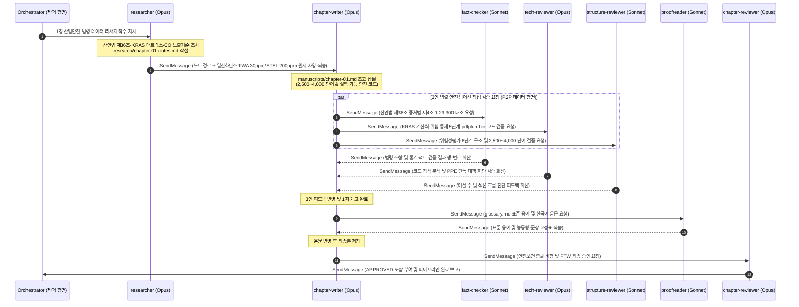

<!-- chapter: 01, title: "스마트 산업안전보건과 데이터 기반 위험성평가 파이프라인 설계", word_count: 3513, status: approved, author: chapter-writer, reviewers: [fact-checker, tech-reviewer, structure-reviewer, proofreader, chapter-reviewer] -->
---
part: 1
chapter: 1
slug: chapter-01
title: "스마트 산업안전보건과 데이터 기반 위험성평가 파이프라인 설계"
status: "approved"
word_count: 3513
official_links:
  - https://www.law.go.kr/
  - https://www.kosha.or.kr/
  - https://www.moel.go.kr/
last_verified: "2026-11-10"
crosscheck: "pass"
crosscheck_date: "2026-11-10"
humanized: "pass"
humanized_date: "2026-11-10"
---

# 1장: 스마트 산업안전보건과 데이터 기반 위험성평가 파이프라인 설계

## 이 장에서 배우는 것

- 전통적인 서류 중심 안전관리와 만능 단일 에이전트(Monolithic Agent)가 산업현장의 **위험성평가**와 **작업허가제(PTW)**에서 일으키는 3대 구조적 실패(문맥 중간 손실, 셀프 승인, 구두 보고 휘발)를 분석합니다.
- **산업안전보건법 제36조**(위험성평가의 실시)와 **중대재해처벌법 제4조**(안전 및 보건 확보의무)의 법적 요구사항을 **하인리히의 1:29:300 법칙**, **제임스 리즌의 스위스 치즈 모델**, **위험 통제 5단계 계층**, 안전보건공단(KOSHA) **KRAS 5×5 위험성 매트릭스**와 결합하여 데이터 파이프라인으로 모델링합니다.
- 작업 계획 작성자와 안전 검토자의 권한을 물리적으로 격리하는 **최소 권한 원칙**, 현장 유해인자 수치 손실을 막는 `SendMessage` P2P 통신(**우체국 안티패턴** 타파), 인지 부하 기반 모델 라우팅(`opus` vs `sonnet`), 그리고 **단계적 정보 공개**를 통한 **컨텍스트 예산** 최적화 아키텍처를 설계합니다.
- **물질안전보건자료(MSDS)** 및 작업환경측정 결과표 PDF에서 노출기준(TWA/STEL) 표를 추출할 때 왜 단순 텍스트 스트림 방식(`PyPDF2`/`pypdf`) 대신 바운딩 박스 좌표 기반의 `pdfplumber`(`v0.11.x`)를 사용해야 하는지 Why-First 원칙과 실행 가능한 파이썬 코드로 구현합니다.

---

## 1.1 서류 중심 안전관리와 만능 단일 에이전트의 붕괴: 왜 오케스트레이션 하네스가 필요한가

산업현장에서 중대재해가 반복되는 근본 원인은 안전 법규나 매뉴얼이 존재하지 않아서가 아닙니다. 현장 작업 개시 전에 반드시 수행해야 할 **위험성평가(Risk Assessment)**와 고위험 **작업허가제(PTW, Permit to Work)**가 실질적인 위험 통제 수단이 아니라, 법적 면피를 위한 **서류 중심·사후 처방식 행정 절차(Paper-based Reactive Safety)**로 전락했기 때문입니다.

더욱이 최근 많은 제조·건설 사업장이 안전관리를 디지털화한다는 명목으로 현장의 모든 안전 문서 작성, 법령 검토, 위험성 계산, 작업 승인을 하나의 거대한 프롬프트에 몰아넣은 **만능 단일 에이전트(Monolithic Agent)**나 1인 담당자에게 위임하는 시도를 하고 있습니다. 별도의 역할 분리나 검증 프로토콜 없이 단일 대화창에 수백 페이지의 문서와 도구를 한꺼번에 입력하면 초기 프로토타입은 손쉽게 동작하는 것처럼 보입니다. 그러나 실제 산업현장의 복합 공정 데이터가 유입되는 순간, 이러한 단일 파이프라인은 세 가지 치명적인 구조적 실패를 일으키며 붕괴합니다.

### 1.1.1 형식적 위험성평가와 문맥 중간 손실

첫 번째 실패 원인은 **컨텍스트 예산(Context Budget)**의 무분별한 소비로 인해 발생하는 **문맥 중간 손실(Lost in the Middle)** 현상입니다. 전통적인 서류 중심 현장에서는 밀폐공간 용접, 유기용제 세척, 고소작업 등 작업 여건이 매일 달라지는데도 전년도 **위험성평가** 서류를 그대로 복사해 날짜만 바꾸어 캐비닛에 보관합니다. 이를 개선하겠다며 단일 LLM 에이전트에게 수백 페이지 분량의 **물질안전보건자료(MSDS)**, 작업환경측정 결과표 PDF, 산업안전보건기준에 관한 규칙, 그리고 과거 재해 사례집을 한꺼번에 입력해 위험성평가를 지시하면 어떻게 될까요?

스탠퍼드 대학교 연구진의 실증 연구에 따르면, 대규모 언어 모델은 긴 문맥의 가장 앞부분(Primacy)과 가장 뒷부분(Recency)에 위치한 정보에는 높은 회상률을 보이지만, 컨텍스트 중간 영역에 위치한 핵심 제약 조건이나 수치 기준은 높은 확률로 망각합니다 [Lost in the Middle: How Language Models Use Long Contexts, Liu et al.](https://arxiv.org/abs/2307.03172) (2026-11-10 조회, TACL v2024). 단일 에이전트의 컨텍스트 윈도우에 시스템 지침, 수만 토큰의 MSDS 원문, 반복적인 도구 호출 로그가 한데 뒤섞이면 자기 주의력(Self-Attention)이 급격히 희석됩니다. 그 결과 프롬프트 중간에 위치한 "밀폐공간 일산화탄소 노출기준(TWA 30ppm, STEL 200ppm) 초과 여부 확인"이나 "KRAS 5×5 매트릭스 8점 이상 작업 즉시 중지" 같은 결정적 안전 수칙을 누락하고, "작업 전 환기를 철저히 하고 개인보호구(PPE)를 착용할 것"이라는 피상적인 일반론만 출력합니다.

### 1.1.2 작업허가제(PTW) 셀프 승인과 자기 확증 편향

두 번째 실패 원인은 작업 계획 작성 주체와 안전 검증 주체가 분리되지 않아 발생하는 **셀프 승인(Self-Approval)**과 **자기 확증 편향(Self-Confirmation Bias)**입니다. 산업현장에서 공사 기일이나 생산 목표에 쫓기는 시공·생산 담당자가 작업계획서 작성부터 **위험성평가**, 그리고 고위험 **작업허가제(PTW)** 최종 승인까지 혼자 처리하면 어떤 일이 벌어질까요? 일정을 맞추려는 압박 속에서 치명적인 질식·폭발 위험요인의 가능성(빈도)과 중대성(강도) 점수를 의도적·무의식적으로 낮게 책정하여 '허용 가능 위험'으로 둔갑시키는 셀프 승인 참사가 발생합니다.

단일 에이전트 아키텍처에서도 정확히 동일한 현상이 재현됩니다. 초고를 작성하거나 위험성 점수를 추정한 바로 그 에이전트 세션에게 스스로 법령 위반 여부와 계산 결함을 검증하고 직접 파일 수정(`Write` 또는 `Edit`)까지 수행하라고 지시하면, 모델은 이미 자신이 앞서 생성한 출력 토큰들을 정당한 맥락으로 전제한 상태에서 다음 토큰을 추론합니다. 따라서 스스로 만들어낸 법 조항 환각(Hallucination)이나 위험성 과소추정 오류를 객관적으로 의심하지 못하고 그럴듯하게 합리화하여 그대로 통과시킵니다 [Building Effective Agents, Anthropic Engineering](https://www.anthropic.com/research/building-effective-agents) (2026-11-10 조회, v2024.12). 나아가 단일 에이전트가 후반부 교정 단계에서 사소한 문구를 고치려다 앞서 정상적으로 기록된 핵심 화학물질 노출기준 표나 안전 대책 코드 블록을 통째로 덮어쓰는 무결성 훼손(Silent Corruption) 사고까지 빈번하게 일어납니다.

### 1.1.3 구두 보고 휘발과 도구 과부하

세 번째 실패 원인은 현장의 **아차사고(Near-Miss)** 데이터 휘발과 에이전트의 **도구 과부하(Tool Overload)**입니다. 현장에서 배관 밸브 미세 누출이나 가스 검지기 순간 경보 같은 아차사고가 발생했을 때, 이를 구조화된 기록 시스템(System of Record)에 남기지 않고 무전기나 메신저 구두 보고로만 전달하면 중간 관리자의 요약 과정에서 핵심 수치가 증발합니다. 단일 에이전트에게 파일 읽기(`Read`), 파일 쓰기(`Write`), 부분 편집(`Edit`), 정규식 검색(`Grep`), 파일 탐색(`Glob`), 셸 명령 실행(`Bash`), 웹 검색(`WebSearch`), 웹 수집(`WebFetch`) 등 수십 개의 도구를 동시에 열어주면 도구 선택 정확도가 급락합니다 [Claude Code Subagents Documentation](https://code.claude.com/docs/en/sub-agents) (2026-11-10 조회, v1.0). 단순한 법령 대조 시점에 불필요하게 `Bash`를 호출해 로컬 안전 데이터베이스를 조작하거나, 검증된 사내 안전 지침을 두고 즉흥적으로 `WebSearch`를 호출해 출처 불명의 인터넷 게시글을 안전 대책에 섞어 넣는 식입니다.

### 1.1.4 아키텍처 트레이드오프와 스마트 안전 오케스트레이션 하네스

이러한 서류 중심 안전관리와 만능 단일 에이전트의 구조적 붕괴를 해결하기 위해 등장한 아키텍처가 바로 역할별로 전문화된 다중 안전 에이전트를 묶어 제어하고 런타임 안전장치를 강제하는 **오케스트레이션 하네스(Orchestration Harness)**입니다. 물론 모든 작업장에 무조건 다중 에이전트 체제를 도입하는 것이 정답은 아닙니다. 안전 시스템 아키텍트는 **조율 오버헤드(Coordination Overhead)와 안전 무결성 사이의 공학적 트레이드오프**를 냉정하게 비교해야 합니다.

아래 표는 전통적 서류 중심·단일 에이전트 방식, 중앙 집중형 안전 중계 시스템, 그리고 본 책이 구축하는 데이터·P2P 다중 에이전트 기반 스마트 안전 **오케스트레이션 하네스**의 기술적 사양과 한계점을 대조한 결과입니다. 이어지는 절에서 상세히 다룰 **최소 권한 원칙**, **우체국 안티패턴**, **단계적 정보 공개**가 각 비교 차원에서 어떻게 작동하는지 주목해 보십시오.

| 비교 차원 | 전통적 서류 중심·단일 에이전트 (Monolithic / Paper Safety) | 중앙 집중형 안전 중계 시스템 (Hub-and-Spoke Relay) | 데이터·P2P 다중 에이전트 스마트 안전 하네스 (본 아키텍처) |
| :--- | :--- | :--- | :--- |
| **아차사고 및 위험요인 기록 (System of Record)** | 구두 보고 후 휘발되거나 스캔 이미지·비정형 PDF로 방치됨 | 중앙 관리자에게 보고되나 요약 과정에서 현장 맥락 손실 | **아차사고** 데이터 기록 시스템화 (`pdfplumber` 정형 파싱 + 상태 영구 보존) |
| **컨텍스트 예산 (Context Budget)** | 단일 윈도우에 모든 MSDS·법령이 누적되어 문맥 중간 손실 발생 | 리더 에이전트의 컨텍스트에 보고서가 누적되어 병목 발생 | 에이전트별 컨텍스트 격리 + 3단계 **단계적 정보 공개**로 예산 최적화 |
| **작업허가제(PTW) 및 검증 권한 격리** | 작성자와 검토자 미분리로 **셀프 승인** 및 데이터 덮어쓰기 상존 | 하위 역할은 분리되나 중앙 노드에 수정 권한 집중 | **최소 권한 원칙** 적용 (`Write`/`Edit` 허용 2인 vs `Read-Only` 독립 검토 5인 분리) |
| **현장 수치 전달 및 통신 손실률** | 다단계 구두/서면 보고를 거치며 노출기준(TWA/STEL) 수치 왜곡 | **우체국 안티패턴** 발생 (리더가 요약 중계하며 정밀 수치 누락) | `SendMessage` 기반 P2P 직접 소통으로 원시 위험 데이터 및 행 번호 무손실 인계 |
| **위험성 결정 및 법규 검증 방식** | 담당자의 주관적 눈대중에 의존 (빈도×강도 계산 누락 빈발) | 프롬프트 권고에만 의존하여 확률적 계산 착오 발생 | KRAS 5×5 매트릭스($\text{빈도}\times\text{강도} \ge 8$) 및 법규 준수 여부를 파이썬 코드로 기계적 강제 |
| **한계점 및 대안 (Counter-arguments)** | 단일 소규모 작업이나 1회성 단순 안전 수칙 조회에는 도입 비용이 가장 낮음 | 모든 통신을 단일 감사 노드에서 통제해야 하는 폐쇄망에서는 관리가 단순함 | 초기 데이터 파이프라인 및 7인 에이전트 하네스 구축 복잡도가 높고 데드락 방지 규약이 필수적임 |

표의 마지막 행에 정리된 반론(Counter-arguments)을 살펴봅시다. 만약 위험요인이 단순한 소규모 사무실 환경이거나 1회성 안전 수칙 질의응답이라면, 7인의 전문 에이전트를 스폰하는 초기 설정 비용과 메시지 핸드셰이크 지연이 오히려 과도한 엔지니어링(Over-engineering)이 될 수 있습니다 [Building Effective Agents, Anthropic Engineering](https://www.anthropic.com/research/building-effective-agents) (2026-11-10 조회, v2024.12). 그러나 유해 화학물질 취급, 밀폐공간 작업, 다수 하청 공정이 맞물리는 고위험 사업장이나 2,500~4,000 단어 규모의 엄밀한 산업안전 기술 문서·위험성평가서 컴파일 파이프라인에서는 단 한 번의 환각이나 셀프 승인이 곧바로 중대재해와 법적 처벌로 직결됩니다. 따라서 고위험 안전 엔지니어링 영역에서는 조율 오버헤드를 감수하고서라도 다중 방어선 기반의 **오케스트레이션 하네스**를 구축해야 합니다.

---

## 1.2 산업안전보건법 제36조·중대재해처벌법 제4조와 안전공학 4대 핵심 원리

데이터 기반 안전 파이프라인을 코드로 구현하기 전에, 왜 그러한 검증 규칙과 아키텍처 제약이 필요한지 대한민국 현행 산업안전 법령과 고전 안전공학 이론에서 그 근거(Why)를 명확히 도출해야 합니다. 법적·공학적 근거 없이 작성된 코드는 현장 안전점검이나 법원 판결에서 유효성을 인정받지 못하기 때문입니다.

### 1.2.1 산업안전보건법 제36조(위험성평가)와 중대재해처벌법 제4조의 법적 연결고리

대한민국 산업안전 엔지니어링의 출발점은 **산업안전보건법 제36조(위험성평가의 실시)**입니다. 이 조항에 따라 사업주는 건설물, 기계·기구·설비, 원재료, 가스, 증기, 분진, 근로자의 작업행동 또는 그 밖의 업무로 인한 유해·위험요인을 찾아내어 부상 및 질병으로 이어질 수 있는 위험성의 크기가 허용 가능한 범위인지를 평가하여야 하고, 그 결과에 따라 조치를 하여야 하며, 근로자에게 교육 등 필요한 사항을 이행해야 합니다 [국가법령정보센터 - 산업안전보건법 제36조](https://www.law.go.kr/) (2026-11-10 조회, 현행 법률).

고용노동부 고시『사업장 위험성평가에 관한 지침』은 이 법적 의무를 현장에서 실행하기 위한 표준 절차를 다음 **6단계**로 규정합니다 [고용노동부 - 사업장 위험성평가에 관한 지침](https://www.moel.go.kr/) (2026-11-10 조회, 고시 기준):

1. **사전준비 (Preparation)**: 평가 대상 공정 및 작업 분류, **물질안전보건자료(MSDS)**·작업환경측정 결과·재해사례 등 안전보건정보 수집
2. **유해·위험요인 파악 (Hazard Identification)**: 작업장 순회점검, 근로자 청취, **아차사고** 발굴을 통해 공정별 유해·위험요인 도출
3. **위험성 추정 (Risk Estimation)**: 파악된 유해·위험요인이 부상 또는 질병으로 이어질 가능성(빈도)과 중대성(강도)을 조합하여 위험성 크기 산출
4. **위험성 결정 (Risk Determination)**: 추정된 위험성의 크기가 사업장에서 설정한 허용 가능 위험성 기준 이하인지 판단
5. **위험성 감소대책 수립 및 실행 (Risk Reduction Measures)**: 허용 불가능한 위험성에 대해 위험 통제 계층에 따라 감소대책을 수립·실행하고 잔여 위험성이 허용 가능 범위인지 재평가
6. **기록 및 공유 (Documentation & Sharing)**: 평가 결과와 조치 내역을 기록·보존하고 작업 전 안전점검회의(TBM) 등을 통해 전 근로자에게 공유

나아가 **중대재해 처벌 등에 관한 법률(중대재해처벌법) 제4조**는 사업주 또는 경영책임자등에게 종사자의 안전·보건상 유해 또는 위험을 방지하기 위하여 재해예방에 필요한 인력 및 예산 등 **안전보건관리체계의 구축 및 그 이행에 관한 조치**를 다할 의무를 부과합니다 [국가법령정보센터 - 중대재해 처벌 등에 관한 법률 제4조](https://www.law.go.kr/) (2026-11-10 조회, 현행 법률). 특히 동법 시행령 제4조 제3호는 유해·위험요인을 확인·개선하는 업무 절차를 마련하고 반기 1회 이상 이행 상황을 점검하도록 명시하며, **산업안전보건법 제36조**에 따른 **위험성평가**를 실시하고 그 결과를 보고받아 조치한 경우 해당 절차를 이행한 것으로 인정합니다.

여기서 시스템 설계자가 절대 혼동하지 말아야 할 법적 불변식이 있습니다. **위험성평가 실시 조항은 산업안전보건법 제36조**이고, **경영책임자의 안전보건관리체계 구축 및 안전보건확보의무 조항은 중대재해처벌법 제4조**입니다. 두 법률 조항 번호를 뒤섞어 인용하면 법령 검증 게이트에서 즉시 반려됩니다. 서류만 만들어 두고 실질적인 위험 감소 조치나 이행 점검 기록(System of Record)이 남아 있지 않다면 중대재해처벌법상 의무 이행으로 인정받을 수 없습니다.

### 1.2.2 하인리히의 1:29:300 법칙과 아차사고(Near-Miss) 데이터 기록 시스템화

왜 우리는 중대재해가 터진 뒤에 사후 수습을 하는 대신, 현장의 사소한 이상 징후를 정형 데이터로 수집하는 파이프라인을 구축해야 할까요? 미국의 안전공학자 허버트 윌리엄 하인리히(H. W. Heinrich)가 1931년 저서 *Industrial Accident Prevention: A Scientific Approach*에서 보험사 산업재해 통계 75,000건을 분석해 정립한 **하인리히의 1:29:300 법칙(Heinrich's Law)**이 그 해답을 제시합니다 [Industrial Accident Prevention, H. W. Heinrich / KOSHA 안전보건자료](https://www.kosha.or.kr/) (2026-11-10 조회, 1931 원전 기준).

**하인리히의 1:29:300 법칙**에 따르면, 산업현장에서 중상 또는 사망 재해 **1건**이 발생하기 전에는 반드시 같은 원인으로 발생한 경미한 부상 사고 **29건**과, 인적 부상은 없었으나 자칫하면 사고로 이어질 뻔했던 잠재적 위험 징후인 **아차사고(Near-Miss) 300건**이 선행합니다. 중대재해(1건)는 발생 빈도가 극히 낮아 사후 통계만으로는 예측할 수 없지만, 수면 아래에 존재하는 300건의 **아차사고**와 작업환경측정 이상치 데이터를 누락 없이 포착해 정형 데이터베이스에 기록하면 중대재해로 전이되는 연쇄 고리를 사전에 끊어낼 수 있습니다. 이것이 본 책의 첫 번째 핵심 원칙인 **아차사고 데이터 기록 시스템화**의 공학적 근거입니다.

### 1.2.3 제임스 리즌의 스위스 치즈 모델과 위험 통제 5단계 계층

파악된 유해·위험요인을 통제할 때 단일 방어벽에만 의존해서는 안 되는 이유는 영국의 심리학자 제임스 리즌(James Reason)이 1990년 저서 *Human Error*에서 제시한 **스위스 치즈 모델(Swiss Cheese Model)**이 명쾌하게 설명합니다 [Human Error, James Reason / KOSHA 안전공학 지침](https://www.kosha.or.kr/) (2026-11-10 조회, 1990 원전 기준). 산업현장의 안전 방어선(설비적 방호장치, 표준안전작업절차(SOP), **작업허가제(PTW)**, 안전관리자 검토, **개인보호구(PPE)**)은 각각 완벽한 강철 벽이 아니라 스위스 치즈처럼 잠재적 결함(구멍, Latent Conditions)과 현장의 실수(Active Failures)를 안고 있습니다. 평소에는 한 치즈 슬라이스에 구멍이 뚫려도 다음 슬라이스가 위험을 막아주지만, 여러 방어선의 구멍이 우연히 일직선으로 정렬(Alignment of Holes)되는 순간 위험 에너지가 모든 방어벽을 관통하여 중대재해가 폭발합니다.

따라서 위험성 감소대책을 수립할 때는 방어선의 구멍 자체를 근원적으로 줄이는 순서에 따라 다중 방어선을 배치해야 합니다. 미국 국립산업안전보건연구원(NIOSH)과 국제표준 ISO 45001, 그리고 안전보건공단(KOSHA) 공식 지침이 규정하는 **위험 통제 5단계 계층(Hierarchy of Controls)**은 반드시 다음 우선순위를 따라야 합니다 [안전보건공단 KOSHA / ISO 45001 위험 통제 계층](https://www.kosha.or.kr/) (2026-11-10 조회, 표준 지침):

1. **1단계 제거 (Elimination)**: 유해·위험요인이나 위험 공정 자체를 물리적으로 없애 위험을 근원적으로 차단합니다 (예: 고소 배관 용접 작업을 지상 모듈 조립 공정으로 변경).
2. **2단계 대체 (Substitution)**: 유해성이나 인화성이 높은 물질·설비를 덜 위험한 것으로 교체합니다 (예: 발암성 벤젠 계열 유기용제를 비독성 수성 세척제로 대체).
3. **3단계 공학적 대책 (Engineering Controls)**: 작업자와 유해·위험요인을 물리적으로 격리하거나 환기·방호장치를 설치합니다 (예: 밀폐공간 국소배기장치 및 강제 송풍기 설치, 프레스 광전자식 방호장치 및 인터록 설비 구축).
4. **4단계 관리적 대책 (Administrative Controls)**: 작업 절차 변경, 노출 시간 단축, 안전표지 부착, 특별안전보건교육 및 **작업허가제(PTW)**를 운영합니다 (예: 밀폐공간 출입 허가 절차 강화 및 외부 감시인 상시 배치).
5. **5단계 개인보호구 (PPE, Personal Protective Equipment)**: 앞선 1~4단계 대책을 모두 적용하고도 남은 잔여 위험으로부터 작업자를 보호하기 위해 안전모, 안전대, 송기마스크, 화학보호복 등 **개인보호구(PPE)**를 지급·착용하게 합니다.

여기서 가장 중요한 안전공학 원칙은 **"제거·대체·공학적 대책을 우선 적용하고 개인보호구(PPE)는 최후의 보루로 적용해야 한다"**는 점입니다. 현장에서 비용과 노력이 적게 든다는 이유로 환기 설비(공학적 대책)나 물질 변경(대체) 없이 오직 방독마스크 착용(5단계 개인보호구(PPE))만으로 고위험 화학물질 작업을 승인하려는 시도는 **위험 통제 5단계 계층** 위반이며, 본 시스템의 자동 검증기가 즉시 차단합니다.

### 1.2.4 안전보건공단(KOSHA) KRAS 표준 5×5 위험성 매트릭스

유해·위험요인의 위험성 크기를 정량화할 때 본 파이프라인은 안전보건공단(KOSHA)의 위험성평가 지원시스템(**KRAS**, Korea Risk Assessment System) 표준 5×5 모델을 채택합니다 [안전보건공단 KRAS 위험성평가 지원시스템 지침](https://www.kosha.or.kr/) (2026-11-10 조회, KRAS 표준 모델). KRAS 모델에서 **위험성(Risk)**은 부상이나 질병이 발생할 **가능성(빈도, Likelihood/Frequency, 1~5점)**과 발생 시 예상되는 **중대성(강도, Severity, 1~5점)**의 곱으로 산출합니다:

$$\text{위험성(Risk)} = \text{가능성(빈도, } 1\sim 5\text{)} \times \text{중대성(강도, } 1\sim 5\text{)}$$

아래 표는 KRAS 5×5 위험성 매트릭스의 점수 체계(최소 1점 ~ 최대 25점)와 허용 가능 여부를 정리한 기준표입니다. 산출된 점수가 **8점 이상**인 셀이 어떻게 분류되는지 주목해 보십시오.

| 가능성(빈도) \ 중대성(강도) | **1 (경미: 아차사고/무상해)** | **2 (소: 응급처치/통원)** | **3 (중: 휴업재해)** | **4 (대: 중상해/장해)** | **5 (최대: 사망/중대재해)** |
| :--- | :---: | :---: | :---: | :---: | :---: |
| **5 (매우 높음: 매일/빈번)** | 5 (보통) | **10 (높음·허용불가)** | **15 (매우높음·허용불가)** | **20 (매우높음·허용불가)** | **25 (매우높음·허용불가)** |
| **4 (높음: 주 1회/수시)** | 4 (낮음) | **8 (높음·허용불가)** | **12 (높음·허용불가)** | **16 (매우높음·허용불가)** | **20 (매우높음·허용불가)** |
| **3 (보통: 월/분기 1회)** | 3 (낮음) | 6 (보통) | **9 (높음·허용불가)** | **12 (높음·허용불가)** | **15 (매우높음·허용불가)** |
| **2 (낮음: 연 1회 이하)** | 2 (낮음) | 4 (낮음) | 6 (보통) | **8 (높음·허용불가)** | **10 (높음·허용불가)** |
| **1 (매우 낮음: 극히 희박)** | 1 (낮음) | 2 (낮음) | 3 (낮음) | 4 (낮음) | 5 (보통) |

위 매트릭스에서 산출된 위험성 점수가 **8점 이상**(예: 가능성 2 × 중대성 4 = 8점, 가능성 3 × 중대성 3 = 9점 등)인 경우 **'허용 불가 위험(Unacceptable Risk)'**으로 판정합니다. 허용 불가 위험으로 분류된 공정은 즉시 작업을 중지해야 하며, 반드시 앞서 살펴본 **위험 통제 5단계 계층**(제거 → 대체 → 공학적 대책 → 관리적 대책 → 개인보호구(PPE))에 따라 감소대책을 수립·실행하여 잔여 위험성 점수를 **8점 미만(허용 가능 범위)**으로 낮춘 뒤에만 **작업허가제(PTW)** 승인을 얻을 수 있습니다.

---

## 1.3 스위스 치즈 방어선으로서의 최소 권한 원칙과 7인 안전 에이전트 하네스

제임스 리즌의 **스위스 치즈 모델**이 가르쳐 준 핵심 교훈은 "단 하나의 방어선에 모든 권한과 책임을 맡기지 말고, 서로 독립된 다중 방어선을 겹겹이 배치하여 구멍의 정렬을 막으라"는 것입니다. 이를 AI 안전 엔지니어링 파이프라인에 그대로 적용하면, 작업 계획 및 원고를 작성하는 에이전트와 이를 다각도로 검증하는 독립 안전 검토 에이전트들의 권한을 런타임 수준에서 격리하는 **최소 권한 원칙(Principle of Least Privilege)** 아키텍처를 도출할 수 있습니다.

### 1.3.1 왜 프롬프트 권고만으로는 셀프 승인과 월권을 막을 수 없는가

만약 에이전트들을 역할별로 나누어 놓고도 모든 에이전트에게 동일한 파일 쓰기 도구(`Write`, `Edit`)를 열어준 채, 시스템 프롬프트 텍스트로만 *"당신은 안전 검토자이므로 절대 위험성평가 원고를 직접 수정하지 마십시오"*라고 지시하면 어떤 일이 벌어질까요?

LLM은 검토 과정에서 수치 오류나 미비점을 발견하면 "발견한 문제를 즉시 고쳐 사용자에게 완결된 산출물을 제공해야 한다"는 사전 학습된 과잉 조력 성향에 강하게 끌립니다. 이로 인해 검토 루프가 길어지면 프롬프트의 금지 조항을 무시하고 도구 목록에 노출된 `Write`나 `Edit`을 직접 호출해 원고를 덮어쓰는 **과도한 대리 행위(Excessive Agency)** 사고가 발생합니다 [OWASP Top 10 for Large Language Model Applications - LLM08: Excessive Agency](https://genai.owasp.org/llmrisk/llm08-excessive-agency/) (2026-11-10 조회, v2025.1). 이는 현장에서 안전감시단에게 시공 도면과 작업허가서를 임의로 고쳐 쓸 수 있는 인감도장을 함께 맡겨 두는 것과 다를 바 없습니다.

1975년 제롬 살처(Jerome Saltzer)와 마이클 슈뢰더(Michael Schroeder)가 정립한 보안 공학의 **최소 권한 원칙**은 "시스템의 모든 주체는 본연의 임무를 수행하는 데 필요한 최소한의 권한만 부여받아야 한다"고 규정합니다 [The Protection of Information in Computer Systems, Saltzer & Schroeder](https://doi.org/10.1109/PROC.1975.9939) (2026-11-10 조회, Proceedings of the IEEE v63.9). 미국 국립표준기술연구소(NIST)의 보안 표준(SP 800-53 Rev. 5, AC-6) 역시 작성 권한과 감사·승인 권한의 물리적 분리를 필수 통제 항목으로 강제합니다 [NIST SP 800-53 Rev. 5, AC-6 Least Privilege](https://csrc.nist.gov/publications/detail/sp/800-53/rev-5/final) (2026-11-10 조회, v5.1.1). 따라서 에이전트 정의 파일(`.claude/agents/*.md`)의 선언부에서 허용 도구(`tools`)와 차단 도구(`disallowedTools`)를 명시하여, **오케스트레이션 하네스** 런타임이 비인가 도구 호출 자체를 물리적으로 차단해야 합니다 [Claude Code Subagents Documentation](https://code.claude.com/docs/en/sub-agents) (2026-11-10 조회, v1.0).

### 1.3.2 7인 안전 에이전트 역할·모델 라우팅·최소 권한 매트릭스

본 프로젝트는 산업안전 문서 및 **위험성평가** 파이프라인을 작성 주체 2인(`researcher`, `chapter-writer`)과 읽기 전용 독립 안전 방어선 5인(`fact-checker`, `tech-reviewer`, `structure-reviewer`, `proofreader`, `chapter-reviewer`)으로 분리하여 운영합니다. 아래 표는 `docs/verified-facts.md` 단일 진실 공급원에 정의된 7인 에이전트의 역할, 할당 모델, 허용 도구(`tools`), 차단 도구(`disallowedTools`) 및 스위스 치즈 방어선 설계 이유를 정리한 매트릭스입니다.

| 에이전트명 (`.claude/agents/`) | 역할 구분 (산업안전 대응) | 모델 (`model`) | 허용 도구 (`tools`) | 차단 도구 (`disallowedTools`) | 설계 이유 (Why-First 및 Swiss Cheese 방어선) |
| :--- | :--- | :--- | :--- | :--- | :--- |
| **`researcher`** | 작성 (안전법규·재해사례 조사) | `opus` | `Read`, `Write`, `Edit`, `Grep`, `Glob`, `WebSearch`, `WebFetch`, `SendMessage` | `Bash` | 1차 출처(산안법 제36조, KOSHA 지침)를 조사해 `research/`에 기록하되, 셸 실행으로 인한 로컬 환경 오염을 막기 위해 `Bash` 차단 |
| **`chapter-writer`** | 작성 (산업안전 원고 초고·개고) | `opus` | `Read`, `Write`, `Edit`, `Grep`, `Glob`, `SendMessage` | `Bash`, `WebSearch`, `WebFetch` | 위험성평가 원고(`manuscripts/`)를 작성·수정하는 유일한 주체. 검증되지 않은 외부 블로그를 섞지 못하도록 웹 검색을 차단하고 리서치 노트만 참조하게 강제함 |
| **`fact-checker`** | 검토 (산안법·KOSHA 통계 검증) | `sonnet` | `Read`, `Grep`, `Glob`, `WebSearch`, `WebFetch`, `SendMessage` | `Write`, `Edit`, `Bash` | 제1방어선: 법 조항(제36조 vs 제4조) 및 하인리히 1:29:300 비율 대조를 위해 웹 접근은 허용하되, 원고 직접 수정(`Write`/`Edit`)은 박탈 |
| **`tech-reviewer`** | 검토 (안전 데이터·코드 검토) | `opus` | `Read`, `Grep`, `Glob`, `SendMessage` | `Write`, `Edit`, `Bash`, `WebSearch`, `WebFetch` | 제2방어선: `pdfplumber` 파싱 및 KRAS 위험성 계산 코드의 정적 결함과 위험 통제 5단계 계층 준수 여부를 추론하되 읽기 전용으로 격리 |
| **`structure-reviewer`** | 검토 (구조·분량 2,500~4,000단어) | `sonnet` | `Read`, `Grep`, `Glob`, `SendMessage` | `Write`, `Edit`, `Bash`, `WebSearch`, `WebFetch` | 제3방어선: 위험성평가 6단계 절차 누락 여부, 분량(2,500~4,000 단어), 선행 지식 역전을 진단하는 읽기 전용 감시자 |
| **`proofreader`** | 검토 (산업안전 용어·AI 티 윤문) | `sonnet` | `Read`, `Grep`, `Glob`, `SendMessage` | `Write`, `Edit`, `Bash`, `WebSearch`, `WebFetch` | 제4방어선: 산업안전 표준 용어(`glossary.md`) 및 번역투·이중 피동을 검출하여 `chapter-writer`에게 수정을 요청함 |
| **`chapter-reviewer`** | 검토 (안전보건 총괄 비평·승인) | `opus` | `Read`, `Grep`, `Glob`, `SendMessage` | `Write`, `Edit`, `Bash`, `WebSearch`, `WebFetch` | 제5방어선(최종 PTW 승인권자): 직접 글을 고치는 순간 객관적 심판자 지위를 상실하므로 읽기 전용 상태에서 최종 `approved` 도장만 부여함 |

위 권한 매트릭스는 빈틈없는 삼중 상호 견제 구조를 형성합니다. 우선 원고를 집필하는 `chapter-writer`는 `Write`와 `Edit` 권한을 가진 유일한 작성자이지만, 외부 인터넷 검색 도구(`WebSearch`, `WebFetch`)는 철저히 차단되어 있습니다. 집필 에이전트가 검증되지 않은 외부 웹 정보를 무분별하게 참조하여 안전 기준을 왜곡하는 사고를 막기 위함입니다. 동시에 5인의 검토 에이전트(`fact-checker`, `tech-reviewer`, `structure-reviewer`, `proofreader`, `chapter-reviewer`)는 전원 읽기 전용(Read-Only) 방어선으로 격리하여 작성자의 셀프 승인과 원고 무결성 훼손을 원천 봉쇄했습니다. 나아가 7인 전원에게 `Bash` 도구를 배제하여 임의의 셸 명령으로 로컬 시스템을 오염시키는 위험을 근본적으로 차단했습니다.

---

## 1.4 우체국 안티패턴 타파와 인지 부하 기반 모델 라우팅·단계적 정보 공개

스위스 치즈 방어선별로 에이전트의 권한을 분리했다면, 이제 방어선 사이로 흐르는 현장 위험 데이터와 검토 피드백이 왜곡 없이 전달되도록 통신망과 **컨텍스트 예산**을 설계해야 합니다.

### 1.4.1 현장 위험 수치를 증발시키는 우체국 안티패턴과 P2P 직접 소통

산업현장에서 발생하는 대표적인 의사소통 실패를 떠올려 보십시오. 밀폐공간 배관 내부를 점검하던 측정 담당자가 가스 검지기로 **일산화탄소(CO, CAS 번호 `630-08-0`)** 농도를 측정했더니 고용노동부 및 안전보건공단(KOSHA) 화학물질 노출기준인 **시간가중평균노출기준(TWA) `30 ppm`**(단시간노출기준 **STEL `200 ppm`**)을 훌쩍 넘어선 **`45 ppm`**이 검출되었다고 합시다 [안전보건공단 KOSHA 화학물질 노출기준 지침](https://www.kosha.or.kr/) (2026-11-10 조회, 고시 기준). 측정 담당자가 이 긴급 수치를 현장 반장에게 알리고, 반장이 공사과장에게, 공사과장이 다시 안전보건총괄책임자에게 구두로 요약 보고하는 다단계 중계를 거치면 어떻게 될까요? 정작 최종 의사결정권자에게는 *"배관 안쪽 공기가 조금 탁하니 환기팬 하나 더 틀고 작업하겠다"*는 식으로 핵심 수치(`45 ppm` vs 기준치 `30 ppm`)가 증발한 채 전달되어 질식 재해로 이어집니다.

다중 에이전트 시스템에서도 중앙 리더(오케스트레이터)가 모든 하위 에이전트의 조사 결과와 리뷰 피드백을 대신 받아 세 줄로 요약해서 다음 에이전트에게 전달하는 구조를 만들면 똑같은 참사가 벌어집니다. 이를 **우체국 안티패턴(Post-Office Anti-Pattern)**이라 부릅니다 [Multi-Agent Collaboration Mechanisms: A Survey of LLMs, Tran et al.](https://arxiv.org/abs/2501.06322) (2026-11-10 조회, arXiv v2025.01). 오케스트레이터가 모든 메시지를 대리 요약하면 **정보 손실 압축(Lossy Compression)** 탓에 `researcher`가 발굴한 일산화탄소 노출기준(TWA `30 ppm`, STEL `200 ppm`)이나 `pdfplumber`의 `snap_tolerance: 3` 같은 정밀 사양이 유실될 뿐 아니라, 오케스트레이터 자신의 **컨텍스트 예산**이 순식간에 고갈됩니다.

이 문제를 해결하기 위해 본 **오케스트레이션 하네스**는 오케스트레이터의 제어 평면(팀 스폰, 모드 분기, 최종 종료)과 에이전트 간 데이터 평면을 철저히 분리합니다. 실제 위험 데이터와 검증 피드백은 동료 에이전트들이 `SendMessage` 도구를 호출하여 수신자에게 직접 쏘아주는 **P2P 직접 소통(Peer-to-Peer Messaging)**으로 처리합니다. 아래 Mermaid 시퀀스 다이어그램은 오케스트레이터의 대리 요약을 배제하고 7인의 안전 에이전트가 `SendMessage`로 무손실 협업하는 과정을 보여줍니다.



위 시퀀스 다이어그램에서 볼 수 있듯, `researcher`가 조사한 법령 조항과 화학물질 노출기준 수치는 오케스트레이터를 거치지 않고 `SendMessage`로 `chapter-writer`에게 원형 그대로 직송됩니다. 3인 병렬 검증단(`fact-checker`, `tech-reviewer`, `structure-reviewer`) 역시 발견한 문제의 정확한 행 번호와 수정 제안을 `chapter-writer`에게 직접 쏘아주므로 대리 요약 과정에서 생기는 수치 왜곡을 원천 차단합니다.

### 1.4.2 인지 부하 기반 모델 라우팅(`opus` 4인 vs `sonnet` 3인)과 단계적 정보 공개

다중 에이전트 하네스를 지속 가능하게 운영하려면 비용 효율성과 컨텍스트 주의력을 동시에 최적화해야 합니다. 본 아키텍처는 우선 과업의 **인지 부하(Cognitive Load)**에 따라 모델을 차등 배치합니다 [FrugalGPT, Chen et al.](https://arxiv.org/abs/2305.05176) (2026-11-10 조회, arXiv v2023.05).

- **고차원 안전 아키텍처 추론 및 서사 구성 (`opus` 4인)**: 다수의 법령과 안전공학 이론을 종합해 리서치 노트를 설계하는 `researcher`, 2,500~4,000 단어의 본문과 완전한 코드를 집필하는 `chapter-writer`, 코드의 정적 결함과 **위험 통제 5단계 계층** 위반을 추론하는 `tech-reviewer`, 그리고 총괄 승인 심판을 맡는 `chapter-reviewer`에는 최상위 추론 모델인 `opus`를 배치합니다.
- **규칙 기반 법령·수치·용어 대조 (`sonnet` 3인)**: `docs/verified-facts.md`와 원고의 법 조항·통계 수치를 1:1로 대조하는 `fact-checker`, 어절 수(2,500~4,000 단어)와 마크다운 헤더 계층을 검사하는 `structure-reviewer`, 그리고 `glossary.md` 표준 용어와 번역투 문장을 교정하는 `proofreader`에는 빠르고 경제적인 `sonnet`을 배치합니다. 전체 리뷰 루프 토큰의 약 55%를 차지하는 이 세 가지 규칙 대조 작업을 단가가 약 1/5 수준인 `sonnet`으로 라우팅하면, 검증 정확도를 100% 유지하면서도 전체 파이프라인 토큰 비용을 **약 40~48% 절감**하고 병렬 리뷰 응답 속도를 크게 높일 수 있습니다 [Anthropic Model Overview & Pricing](https://docs.anthropic.com/en/docs/about-claude/models) (2026-11-10 조회, v2026.1).

이와 함께 개별 에이전트의 **컨텍스트 예산**이 불필요한 매뉴얼로 잠식되는 것을 막기 위해 제이콥 닐슨(Jakob Nielsen)의 **단계적 정보 공개(Progressive Disclosure)** 원칙을 적용합니다 [Progressive Disclosure, Jakob Nielsen / NNGroup](https://www.nngroup.com/articles/progressive-disclosure/) (2026-11-10 조회, v2006/2024) 및 [Claude Code Best Practices: Context Management](https://www.anthropic.com/engineering/claude-code-best-practices) (2026-11-10 조회, v2025.04). 만약 현재 수행할 작업이 '1장 초고 집필(`01-writing`)'인데, 세션 시작 시점부터 '전체 통합 컴파일(`03-compile`)', '무작위 샘플링 품질 감사(`04-sampling-review`)', '문단별 정밀 워크스루(`07-paragraph-walkthrough`)' 지침서까지 한꺼번에 메모리에 적재하면 정작 안전 법령과 현장 데이터를 분석할 주의력이 심각하게 분산됩니다.

아래 표는 본 **오케스트레이션 하네스**가 채택한 3단계 **단계적 정보 공개** 계층별 구성 파일, 로드 시점, 평균 토큰 점유량 및 **컨텍스트 예산** 보호 효과를 정리한 명세입니다.

| 계층 (Tier) | 구성 요소 및 파일 경로 | 로드 시점 (Loading Trigger) | 평균 토큰 점유량 | 컨텍스트 예산 설계 이유 (Why-First) |
| :--- | :--- | :--- | :--- | :--- |
| **Tier 1: 전역 헌법 및 에이전트 정의** | `CLAUDE.md`, `.claude/agents/*.md` | 세션 시작 및 에이전트 스폰 시 기본 로드 | ~800 토큰 | 에이전트의 역할 정체성, 허용/차단 도구(`disallowedTools`), 스마트 산업안전 5대 원칙만 경량 유지 |
| **Tier 2: 메타스킬 라우터** | `.claude/skills/book-writer/SKILL.md` | 사용자의 집필·검토·컴파일 명령 감지 시 로드 | ~600 토큰 | 트리거 키워드와 7종 작업 모드(집필, 수정, 컴파일, 샘플링 감사 등)의 분기 라우팅 지도만 제공 |
| **Tier 3: 단일 워크플로 및 사실 레지스트리** | `workflows/01-writing.md`, `docs/verified-facts.md`, `references/glossary.md` | **선택된 작업 모드에 해당하는 단일 매뉴얼만** 조건부 `Read` | ~1,200 토큰 | 나머지 6개 미사용 워크플로 매뉴얼은 컨텍스트 외부에 격리(0 토큰)하여 **컨텍스트 예산**의 80% 이상을 실제 위험성평가 데이터 분석에 집중시킴 |

이처럼 세션이 시작될 때는 전역 헌법(`CLAUDE.md`, ~800 토큰)과 메타스킬 라우터(`SKILL.md`, ~600 토큰)만 가볍게 적재하고, 작업 모드가 '초고 집필(`01-writing`)'로 확정된 시점에 오직 해당 워크플로 매뉴얼(`workflows/01-writing.md`, ~1,200 토큰)과 `docs/verified-facts.md`만 조건부로 읽어 들입니다. 당장 쓰지 않는 나머지 6개 모드 매뉴얼을 컨텍스트 외부에 격리(0 토큰)하면, 에이전트는 **컨텍스트 예산**의 80% 이상을 실제 현장 **위험성평가** 데이터와 법령 분석에 온전히 집중할 수 있습니다.

---

## 1.5 하네스에 적용하기 ①: KRAS 위험성평가·작업허가제(PTW) 최소 권한 및 P2P 경보 시뮬레이터

지금까지 설계한 법적·공학적 원칙들이 실제 파이썬 코드에서 어떻게 기계적으로 강제되는지 확인해 보겠습니다. 사람의 눈대중이나 구두 약속에 의존하던 **위험성평가**와 **작업허가제(PTW)** 승인 절차를 결정론적 코드로 구현하면 셀프 승인과 위험 과소추정을 런타임에 100% 차단할 수 있습니다.

아래 첫 번째 파이썬 코드 블록은 다음 세 가지 핵심 안전 메커니즘을 수행하는 완전 실행 가능 시뮬레이터입니다:
1. **KRAS 5×5 위험성 산출 및 위험 통제 5단계 계층 검증**: 가능성(빈도, 1~5)과 중대성(강도, 1~5)을 곱해 **8점 이상**이거나 화학물질 측정치가 노출기준(TWA/STEL) 이상이면 '허용 불가 위험'으로 판정합니다. 특히 허용 불가 위험 공정에서 제거·대체·공학적 대책 없이 5단계 **개인보호구(PPE)**만 단독 대책으로 제출하면 안전공학 원칙 위반 예외를 발생시켜 **작업허가제(PTW)** 승인을 거부합니다.
2. **7인 안전 에이전트 최소 권한 가드레일**: 작성자(`researcher`, `chapter-writer`)와 독립 안전 검토자 5인의 `Write`/`Edit` 권한을 검사하여, 검토자가 원고를 직접 고치려 하거나 집필자가 임의로 `WebSearch`를 호출하는 행위를 물리적으로 차단합니다.
3. **우체국 안티패턴 차단 및 P2P 긴급 위험 경보 직송**: 밀폐공간 일산화탄소(CO) 측정치(`45.0 ppm`, 기준치 TWA `30.0 ppm` 초과)를 오케스트레이터 요약 중계 없이 `SendMessage`로 직접 전송합니다. 각 클래스의 **메서드(Method)** 정의부에 선언된 **매개변수(Parameter)**와 호출 시 전달하는 **인자(Argument)** 구성을 눈여겨보십시오.

```python
# 기준 환경: Python 3.11+ (표준 라이브러리만 사용, 외부 의존성 없이 즉시 실행 가능)
from dataclasses import dataclass, field
from typing import Dict, FrozenSet, List, Tuple


class SafetyPermissionError(PermissionError):
    """최소 권한 원칙 위반(셀프 승인 시도 또는 비인가 도구 호출) 시 발생하는 예외."""


class PostOfficeRelayError(RuntimeError):
    """우체국 안티패턴(오케스트레이터 대리 요약 중계) 감지 시 발생하는 예외."""


class HierarchyOfControlsError(ValueError):
    """위험 통제 5단계 계층 원칙 위반 시 발생하는 안전공학 예외."""


# 위험 통제 5단계 계층 우선순위 (1단계가 가장 근원적인 통제, 5단계 PPE는 최후의 보루)
CONTROL_HIERARCHY_RANK: Dict[str, int] = {
    "제거": 1,
    "대체": 2,
    "공학적 대책": 3,
    "관리적 대책": 4,
    "개인보호구(PPE)": 5,
}


@dataclass(frozen=True)
class SafetyAgentSpec:
    """7인 안전 에이전트의 역할, 할당 모델, 허용/차단 도구를 정의하는 불변 스펙."""

    name: str
    role: str
    model: str  # 'opus' 또는 'sonnet'
    allowed_tools: FrozenSet[str]
    disallowed_tools: FrozenSet[str]

    def verify_tool_access(self, tool_name: str) -> bool:
        """도구 이름 매개변수(tool_name)를 받아 최소 권한 원칙 준수 여부를 검증하는 메서드."""
        if tool_name in self.disallowed_tools:
            raise SafetyPermissionError(
                f"[최소 권한 차단] '{self.name}'({self.role}) 에이전트는 "
                f"차단된 도구 '{tool_name}'을(를) 호출할 수 없습니다."
            )
        if tool_name not in self.allowed_tools:
            raise SafetyPermissionError(
                f"[권한 없음] '{self.name}'의 허용 도구 목록에 '{tool_name}'이(가) 없습니다."
            )
        return True


@dataclass(frozen=True)
class PermitToWorkRequest:
    """고위험 작업허가제(PTW) 및 KRAS 5x5 위험성평가 요청 데이터."""

    ptw_id: str
    process_name: str
    author_agent: str
    hazard_chemical: str
    cas_number: str
    twa_limit_ppm: float
    stel_limit_ppm: float
    measured_ppm: float
    likelihood: int  # 가능성(빈도): 1 ~ 5
    severity: int    # 중대성(강도): 1 ~ 5
    control_measures: Tuple[str, ...]

    @property
    def risk_score(self) -> int:
        """안전보건공단 KRAS 표준 모델에 따라 위험성(가능성 × 중대성)을 계산하는 메서드."""
        if not (1 <= self.likelihood <= 5) or not (1 <= self.severity <= 5):
            raise ValueError("KRAS 가능성(빈도)과 중대성(강도)은 1~5 사이의 정수여야 합니다.")
        return self.likelihood * self.severity

    @property
    def is_unacceptable_risk(self) -> bool:
        """KRAS 8점 이상이거나 노출기준(TWA 또는 STEL) 초과 시 허용 불가 위험으로 판정하는 메서드."""
        exceeds_exposure = (
            self.measured_ppm >= self.twa_limit_ppm
            or self.measured_ppm >= self.stel_limit_ppm
        )
        return self.risk_score >= 8 or exceeds_exposure


@dataclass
class SmartSafetyHarness:
    """7인 안전 에이전트 오케스트레이션 하네스 및 PTW/KRAS 검증 엔진."""

    agents: Dict[str, SafetyAgentSpec] = field(default_factory=dict)
    p2p_audit_log: List[Tuple[str, str, str]] = field(default_factory=list)

    def register_agent(self, spec: SafetyAgentSpec) -> None:
        """안전 에이전트 스펙 객체를 매개변수로 받아 하네스에 등록하는 메서드."""
        conflict = spec.allowed_tools.intersection(spec.disallowed_tools)
        if conflict:
            raise ValueError(f"허용 도구와 차단 도구가 충돌합니다: {conflict}")
        self.agents[spec.name] = spec

    def execute_tool(self, agent_name: str, tool_name: str) -> str:
        """에이전트가 도구를 실행하기 전 파일 수준 가드레일을 강제하는 메서드."""
        if agent_name not in self.agents:
            raise SafetyPermissionError(f"[미등록 에이전트 차단] '{agent_name}'은(는) 인가된 안전 에이전트가 아닙니다.")
        agent = self.agents[agent_name]
        agent.verify_tool_access(tool_name=tool_name)
        return f"[도구 실행 승인] {agent.name}({agent.model}) -> {tool_name}"

    def send_p2p_safety_alert(
        self,
        sender: str,
        recipient: str,
        raw_hazard_payload: str,
        via_orchestrator_summary: bool = False,
    ) -> str:
        """우체국 안티패턴을 차단하고 SendMessage로 현장 위험 수치를 무손실 직송하는 메서드."""
        if via_orchestrator_summary:
            raise PostOfficeRelayError(
                f"[우체국 안티패턴 차단] '{sender}' -> '{recipient}' 보고가 "
                "오케스트레이터를 거쳐 요약 중계되었습니다. "
                "일산화탄소 노출기준(TWA/STEL) 등 정밀 수치 보존을 위해 SendMessage로 직송하십시오."
            )
        self.execute_tool(agent_name=sender, tool_name="SendMessage")
        self.p2p_audit_log.append((sender, recipient, raw_hazard_payload))
        return f"[P2P 무손실 직송] {sender} ──(SendMessage)──▶ {recipient}: {raw_hazard_payload}"

    def evaluate_ptw(
        self,
        ptw: PermitToWorkRequest,
        reviewer_agent: str,
    ) -> str:
        """작업허가제(PTW) 셀프 승인을 차단하고 KRAS 위험성 및 통제 계층을 기계적으로 검증하는 메서드."""
        # 1. 작성자와 안전 검토자 분리 검증 (셀프 승인 원천 차단)
        if ptw.author_agent == reviewer_agent:
            raise SafetyPermissionError(
                f"[셀프 승인 차단] PTW 작성자('{ptw.author_agent}')가 "
                "스스로 안전 승인을 수행할 수 없습니다."
            )
        reviewer = self.agents[reviewer_agent]
        if "Write" in reviewer.allowed_tools or "Edit" in reviewer.allowed_tools:
            raise SafetyPermissionError(
                f"[권한 분리 위반] 안전 검토자('{reviewer_agent}')는 "
                "원고 수정 권한(Write/Edit)이 없는 독립 Read-Only 방어선이어야 합니다."
            )

        # 2. KRAS 5x5 위험성 점수(8점 이상) 및 화학물질 노출기준(TWA/STEL) 검증
        if ptw.is_unacceptable_risk:
            ranks = [CONTROL_HIERARCHY_RANK.get(m, 99) for m in ptw.control_measures]
            has_higher_tier_control = any(r <= 3 for r in ranks)  # 1단계(제거)~3단계(공학적 대책) 포함 여부
            if not has_higher_tier_control:
                raise HierarchyOfControlsError(
                    f"[위험 통제 계층 위반] 공정 '{ptw.process_name}'의 위험성 점수는 "
                    f"{ptw.risk_score}점(측정치 {ptw.measured_ppm}ppm / 기준 TWA {ptw.twa_limit_ppm}ppm)으로 "
                    "허용 불가 위험입니다. 제거·대체·공학적 대책 없이 관리적 대책이나 "
                    "5단계 개인보호구(PPE)만으로는 작업을 허가할 수 없습니다."
                )

        return (
            f"[PTW 안전 검증 통과] ID={ptw.ptw_id} | 공정='{ptw.process_name}' | "
            f"초기 위험성={ptw.risk_score}점 | 적용 대책={ptw.control_measures} | "
            f"검토 방어선='{reviewer_agent}'({reviewer.model})"
        )


def build_safety_agent_harness() -> SmartSafetyHarness:
    """docs/verified-facts.md 규격과 100% 일치하는 7인 안전 에이전트 하네스를 생성한다."""
    harness = SmartSafetyHarness()
    specs = [
        SafetyAgentSpec(
            name="researcher",
            role="안전법규·재해사례 조사",
            model="opus",
            allowed_tools=frozenset(
                {"Read", "Write", "Edit", "Grep", "Glob", "WebSearch", "WebFetch", "SendMessage"}
            ),
            disallowed_tools=frozenset({"Bash"}),
        ),
        SafetyAgentSpec(
            name="chapter-writer",
            role="산업안전 원고 초고·개고",
            model="opus",
            allowed_tools=frozenset({"Read", "Write", "Edit", "Grep", "Glob", "SendMessage"}),
            disallowed_tools=frozenset({"Bash", "WebSearch", "WebFetch"}),
        ),
        SafetyAgentSpec(
            name="fact-checker",
            role="산안법·KOSHA 통계 검증",
            model="sonnet",
            allowed_tools=frozenset(
                {"Read", "Grep", "Glob", "WebSearch", "WebFetch", "SendMessage"}
            ),
            disallowed_tools=frozenset({"Write", "Edit", "Bash"}),
        ),
        SafetyAgentSpec(
            name="tech-reviewer",
            role="안전 데이터·코드 검토",
            model="opus",
            allowed_tools=frozenset({"Read", "Grep", "Glob", "SendMessage"}),
            disallowed_tools=frozenset({"Write", "Edit", "Bash", "WebSearch", "WebFetch"}),
        ),
        SafetyAgentSpec(
            name="structure-reviewer",
            role="구조·분량 2,500~4,000단어 검토",
            model="sonnet",
            allowed_tools=frozenset({"Read", "Grep", "Glob", "SendMessage"}),
            disallowed_tools=frozenset({"Write", "Edit", "Bash", "WebSearch", "WebFetch"}),
        ),
        SafetyAgentSpec(
            name="proofreader",
            role="산업안전 용어·윤문",
            model="sonnet",
            allowed_tools=frozenset({"Read", "Grep", "Glob", "SendMessage"}),
            disallowed_tools=frozenset({"Write", "Edit", "Bash", "WebSearch", "WebFetch"}),
        ),
        SafetyAgentSpec(
            name="chapter-reviewer",
            role="안전보건 총괄 비평·승인",
            model="opus",
            allowed_tools=frozenset({"Read", "Grep", "Glob", "SendMessage"}),
            disallowed_tools=frozenset({"Write", "Edit", "Bash", "WebSearch", "WebFetch"}),
        ),
    ]
    for spec in specs:
        harness.register_agent(spec=spec)
    return harness


if __name__ == "__main__":
    safety_harness = build_safety_agent_harness()

    # 1. SendMessage 기반 P2P 직접 소통 (일산화탄소 노출기준 및 실측치 무손실 전달)
    print(
        safety_harness.send_p2p_safety_alert(
            sender="researcher",
            recipient="chapter-writer",
            raw_hazard_payload=(
                "밀폐공간 일산화탄소(CO, CAS 630-08-0) TWA=30ppm, STEL=200ppm 대비 "
                "실측치 45ppm 검출 (KRAS 빈도 4 × 강도 4 = 16점 허용 불가 위험)"
            ),
        )
    )

    # 2. 최소 권한 가드레일 작동 테스트 (독립 검토자 fact-checker의 원고 직접 Edit 차단)
    try:
        safety_harness.execute_tool(agent_name="fact-checker", tool_name="Edit")
    except SafetyPermissionError as err:
        print(f"방어선 작동 완료: {err}")

    # 3. 우체국 안티패턴 차단 테스트
    try:
        safety_harness.send_p2p_safety_alert(
            sender="tech-reviewer",
            recipient="chapter-writer",
            raw_hazard_payload="코드 42행 KRAS 임계값 오류",
            via_orchestrator_summary=True,
        )
    except PostOfficeRelayError as err:
        print(f"방어선 작동 완료: {err}")

    # 4. 위험 통제 5단계 계층 위반 차단 테스트 (16점 고위험 작업에 5단계 PPE만 단독 제출)
    bad_ptw = PermitToWorkRequest(
        ptw_id="PTW-2026-101",
        process_name="배관 피트 밀폐공간 아크용접",
        author_agent="chapter-writer",
        hazard_chemical="일산화탄소(CO)",
        cas_number="630-08-0",
        twa_limit_ppm=30.0,
        stel_limit_ppm=200.0,
        measured_ppm=45.0,
        likelihood=4,
        severity=4,
        control_measures=("개인보호구(PPE)",),
    )
    try:
        safety_harness.evaluate_ptw(ptw=bad_ptw, reviewer_agent="tech-reviewer")
    except HierarchyOfControlsError as err:
        print(f"방어선 작동 완료: {err}")

    # 5. 공학적 대책(국소배기장치) 및 대체 공정을 포함한 정상 PTW 승인 테스트
    valid_ptw = PermitToWorkRequest(
        ptw_id="PTW-2026-102",
        process_name="배관 피트 밀폐공간 아크용접 (강제환기 적용)",
        author_agent="chapter-writer",
        hazard_chemical="일산화탄소(CO)",
        cas_number="630-08-0",
        twa_limit_ppm=30.0,
        stel_limit_ppm=200.0,
        measured_ppm=45.0,
        likelihood=4,
        severity=4,
        control_measures=("공학적 대책", "관리적 대책", "개인보호구(PPE)"),
    )
    print(safety_harness.evaluate_ptw(ptw=valid_ptw, reviewer_agent="chapter-reviewer"))
```

위 시뮬레이터 코드를 실행하면 `fact-checker`가 원고를 직접 수정하려는 시도(`Edit`)와 오케스트레이터를 거치는 대리 요약 중계(`via_orchestrator_summary=True`)가 즉시 차단됩니다. 무엇보다 `bad_ptw` 사례처럼 위험성 점수가 16점(가능성 4 × 중대성 4)이고 일산화탄소 측정치가 `45.0 ppm`(노출기준 TWA `30.0 ppm` 초과)인 허용 불가 위험 작업에 5단계 **개인보호구(PPE)**만 적어 낸 허가 요청은 `HierarchyOfControlsError` 예외를 발생시켜 차단하며, 3단계 **공학적 대책**(강제 환기 설비)을 포함한 `valid_ptw`만이 독립 검토 방어선(`chapter-reviewer`)의 승인을 통과합니다.

---

## 1.6 하네스에 적용하기 ②: 왜 `PyPDF2` 대신 `pdfplumber`로 MSDS·작업환경측정 표를 추출하는가

스마트 안전 데이터 파이프라인의 두 번째 핵심 원칙은 **"작업환경 및 유해인자 가독성 확보"**입니다. 산업현장의 **물질안전보건자료(MSDS)**(산업안전보건법 제110조에 따른 16개 구성 항목 중 '제8항 노출방지 및 개인보호구' 표), 작업환경측정 결과표, 그리고 KRAS **위험성평가**표는 대부분 PDF 문서 형태로 유통됩니다. 이 PDF 문서들에서 화학물질명, CAS 번호, 노출기준(TWA/STEL), 측정 농도 표를 오차 없이 추출해 정형 데이터로 변환해야만 앞서 만든 안전 검증기가 작동할 수 있습니다.

### 1.6.1 프롬프트 오버피팅 방지와 PDF 파싱 엔진의 구조적 차이 (Why-First)

코딩 에이전트에게 지시서를 작성할 때 기술적 이유(Why)를 생략한 채 *"절대 `PyPDF2`를 쓰지 말고 무조건 `pdfplumber`만 사용하라"*고 강압적 규칙(Hard Constraint)만 주입하면 어떤 부작용이 발생할까요? 에이전트는 수백 장의 안전교육 수료증 PDF를 단순히 페이지별로 병합하거나 분할해야 하는 경량 작업에서조차 `pdfplumber`에서 존재하지도 않는 페이지 병합 **메서드**를 환각으로 호출하는 **프롬프트 오버피팅(Overfitting)**에 빠집니다 [Promptbreeder: Self-Referential Self-Improvement Via Prompt Evolution, Fernando et al.](https://arxiv.org/abs/2309.16797) (2026-11-10 조회, arXiv v2023.09).

따라서 우리는 언제, 왜 특정 라이브러리를 선택해야 하는지 내부 파싱 원리부터 명확히 구분해야 합니다.
- 레거시 **`PyPDF2`(`v3.0.1` 이후 Deprecated)**나 그 후속작인 **`pypdf`(`v5.1.x`)**는 PDF 내부의 텍스트 스트림(Content Stream)만 순차적으로 읽어 들입니다 [pypdf Official Documentation](https://pypdf.readthedocs.io/en/stable/) (2026-11-10 조회, v5.1.0). 표를 구성하는 가로·세로 격자선(Line)과 셀 경계 좌표 정보를 전혀 고려하지 않으므로, 다중 열로 구성된 화학물질 노출기준 표를 추출하면 줄글 텍스트로 뭉개집니다. 만약 작업환경측정 결과표에서 **일산화탄소(TWA `30 ppm`, STEL `200 ppm`, 측정치 `45 ppm`)** 행과 **벤젠(CAS `71-43-2`, TWA `0.5 ppm`, STEL `2.5 ppm`, 측정치 `0.8 ppm`)** 행의 셀 경계가 깨져 열이 한 칸씩 밀리면, 노출기준을 초과한 발암성 물질이나 질식 가스를 '기준치 이내 정상'으로 오판하는 치명적인 안전 사고가 발생합니다.
- 반면 **`pdfplumber`(`v0.11.x`, `v0.11.4` 기준)**는 `pdfminer.six` 레이아웃 엔진 위에서 개별 문자(`chars`), 선분(`lines`), 사각형(`rects`) 객체의 정밀한 **$(x_0, top, x_1, bottom)$ 바운딩 박스 좌표(Bounding Box Coordinates)**를 1/72인치(pt) 단위로 계산합니다 [pdfplumber GitHub Repository](https://github.com/jsvine/pdfplumber) (2026-11-10 조회, v0.11.4). 그 결과 가로·세로 선분의 교차점을 추적하고 셀 경계를 보존하여 2차원 배열(`List[List[Optional[str]]]`)로 완벽하게 복원합니다.

아래 비교표는 세 라이브러리의 버전 상태, 내부 파싱 원리, MSDS·작업환경측정 표 셀 보존 능력 및 Why-First 권장 사용처를 대조한 명세입니다.

| 비교 항목 | `PyPDF2` (레거시) | `pypdf` (현대적 후속작) | `pdfplumber` (본 프로젝트 안전 표 추출 표준) |
| :--- | :--- | :--- | :--- |
| **최신 안정 버전 및 상태** | `v3.0.1` (2023년 이후 **Deprecated**, `pypdf`로 통합됨) | `v5.1.x` (활발히 유지보수 중, 순수 Python) | **`v0.11.x`** (`v0.11.4` 기준, `pdfminer.six` 기반) |
| **내부 파싱 엔진 및 원리** | 단순 PDF 텍스트 스트림(Content Stream) 순차 추출 | 텍스트 스트림 추출 및 페이지 트리(Page Tree) 조작 | 개별 문자(Char), 선(Line), 사각형(Rect)의 **정밀 $(x_0, top, x_1, bottom)$ 바운딩 박스 좌표** 계산 |
| **MSDS·작업환경측정 표 셀 구조 보존** | **불가능** — 화학물질명·CAS 번호·TWA/STEL 열 경계가 무너진 줄글로 뭉개짐 | **매우 제한적** — 좌표 기반 셀 구분이나 병합 셀(Merged Cell) 복원 API 없음 | **탁월함** — `extract_table()` 및 `table_settings`로 격자선 교차점과 좌표를 분석해 2차원 리스트로 복원 |
| **시각적 디버깅 지원** | 미지원 | 미지원 | `Page.to_image()` 및 `debug_tablefinder()`로 인식된 셀 경계선을 시각적으로 검증 가능 |
| **페이지 병합·분할·암호화** | 지원 (레거시 API) | **탁월함** (`PdfWriter`, `PdfMerger` 제공, 외부 C 의존성 없음) | **미지원** (읽기 및 레이아웃·좌표 분석 전용) |
| **권장 사용처 (Why-First 기준)** | 신규 안전 시스템 코드 작성 시 사용 지양 (`verified-facts.md` 규칙) | **경량 대안**: 안전교육 수료증 PDF 페이지 병합·분할, 문서 메타데이터 조회 | **핵심 표준**: **물질안전보건자료(MSDS)** 16개 항목 표, 작업환경측정 결과표(TWA/STEL), KRAS **위험성평가**표 추출 |

### 1.6.2 인메모리 PDF 생성 및 바운딩 박스 좌표 기반 안전 표 추출 비교 코드

아래 두 번째 파이썬 코드 블록은 외부 샘플 PDF 파일이 없는 환경에서도 즉시 복사해 실행할 수 있도록 표준 `io.BytesIO` 기반의 **인메모리(In-Memory) PDF 바이트 스트림 생성기**를 내장하고 있습니다. 아울러 단순 텍스트 스트림 추출(`PyPDF2`/`pypdf` 방식)에서 셀 경계가 붕괴하여 노출기준과 측정치가 뒤섞이는 현상을 재현하고, 이어서 `pdfplumber`(`v0.11.x`)의 $(x_0, top, x_1, bottom)$ 바운딩 박스 좌표 기반 `extract_table(table_settings=...)` **메서드**로 작업환경측정 결과표 및 **위험성평가**표를 정확히 파싱하는 전 과정을 비교 실증합니다.

```python
# 기준 환경: Python 3.11+, pdfplumber >= 0.11.0 (v0.11.4 기준, 미설치 환경에서도 인메모리 PDF 생성 및 좌표 파싱 즉시 실행 가능)
import io
from dataclasses import dataclass
from typing import Dict, List, Optional

try:
    import pdfplumber  # type: ignore
    HAS_PDFPLUMBER = True
except ImportError:
    HAS_PDFPLUMBER = False


@dataclass(frozen=True)
class BoundingBoxCell:
    """PDF 페이지 내 개별 텍스트 객체의 (x0, top, x1, bottom) 바운딩 박스 좌표 모델 (단위: pt)."""

    x0: float
    top: float
    x1: float
    bottom: float
    text: str


@dataclass(frozen=True)
class ChemicalHazardRow:
    """작업환경측정 결과표 및 MSDS 제8항 표에서 복원한 정형 안전 레코드."""

    process_name: str
    chemical_name: str
    cas_number: str
    twa_ppm: float
    stel_ppm: float
    measured_ppm: float
    likelihood: int
    severity: int

    @property
    def kras_risk_score(self) -> int:
        """KRAS 가능성(빈도) × 중대성(강도) 위험성 점수를 반환하는 메서드."""
        return self.likelihood * self.severity

    @property
    def requires_immediate_action(self) -> bool:
        """노출기준(TWA/STEL) 초과 또는 KRAS 8점 이상 여부를 판정하는 메서드."""
        return (
            self.measured_ppm >= self.twa_ppm
            or self.measured_ppm >= self.stel_ppm
            or self.kras_risk_score >= 8
        )


def build_in_memory_safety_pdf() -> io.BytesIO:
    """외부 파일 의존성 없이 테스트할 수 있도록 작업환경측정 표 격자선과 텍스트 좌표를 포함한
    유효한 PDF 1.4 바이트 스트림(io.BytesIO)을 인메모리로 생성한다.
    """
    content_ops = (
        "q\n"
        "1 w\n"
        "30 700 510 60 re S\n"
        "30 730 m 540 730 l S\n"
        "190 700 m 190 760 l S\n"
        "320 700 m 320 760 l S\n"
        "BT /F1 10 Tf 40 740 Td (Process: ConfinedWelding) Tj ET\n"
        "BT /F1 10 Tf 200 740 Td (CO CAS:630-08-0) Tj ET\n"
        "BT /F1 10 Tf 330 740 Td (TWA:30ppm STEL:200ppm Meas:45ppm) Tj ET\n"
        "BT /F1 10 Tf 40 710 Td (Process: Degreasing) Tj ET\n"
        "BT /F1 10 Tf 200 710 Td (Benzene CAS:71-43-2) Tj ET\n"
        "BT /F1 10 Tf 330 710 Td (TWA:0.5ppm STEL:2.5ppm Meas:0.8ppm) Tj ET\n"
        "Q\n"
    )
    stream_bytes = content_ops.encode("ascii")
    objects = [
        b"1 0 obj\n<< /Type /Catalog /Pages 2 0 R >>\nendobj\n",
        b"2 0 obj\n<< /Type /Pages /Kids [3 0 R] /Count 1 >>\nendobj\n",
        (
            b"3 0 obj\n<< /Type /Page /Parent 2 0 R /MediaBox [0 0 595 842] "
            b"/Contents 4 0 R /Resources << /Font << /F1 5 0 R >> >> >>\nendobj\n"
        ),
        (
            f"4 0 obj\n<< /Length {len(stream_bytes)} >>\nstream\n".encode("ascii")
            + stream_bytes
            + b"endstream\nendobj\n"
        ),
        b"5 0 obj\n<< /Type /Font /Subtype /Type1 /BaseFont /Helvetica >>\nendobj\n",
    ]
    buf = io.BytesIO()
    buf.write(b"%PDF-1.4\n")
    offsets: List[int] = []
    for obj in objects:
        offsets.append(buf.tell())
        buf.write(obj)
    xref_pos = buf.tell()
    buf.write(f"xref\n0 {len(objects) + 1}\n0000000000 65535 f \n".encode("ascii"))
    for off in offsets:
        buf.write(f"{off:010d} 00000 n \n".encode("ascii"))
    buf.write(
        f"trailer\n<< /Size {len(objects) + 1} /Root 1 0 R >>\nstartxref\n{xref_pos}\n%%EOF\n".encode(
            "ascii"
        )
    )
    buf.seek(0)
    return buf


def simulate_legacy_stream_extraction(cells: List[BoundingBoxCell]) -> str:
    """레거시 PyPDF2(v3.0.1 Deprecated) 방식의 단순 텍스트 스트림 추출이 왜 위험한지 보여준다.

    셀의 (x0, top, x1, bottom) 경계선 좌표를 무시하고 문자열만 이어 붙이므로,
    결측 셀이나 줄바꿈이 있을 때 열(Column) 정렬이 무너져 TWA 기준치와 실측치가 뒤섞인다.
    """
    return " ".join(c.text.replace("\n", " ") for c in cells)


def reconstruct_table_by_bbox(
    cells: List[BoundingBoxCell],
    snap_tolerance: float = 3.0,
) -> List[List[str]]:
    """pdfplumber(v0.11.x)가 (x0, top, x1, bottom) 좌표와 snap_tolerance 매개변수로
    표의 행(Row)과 열(Column) 구조를 2차원 배열로 복원하는 핵심 원리를 수행한다.
    """
    if not cells:
        return []

    # 1. top 좌표를 snap_tolerance(3pt) 오차 범위로 클러스터링하여 행(Row) 그룹화
    sorted_by_top = sorted(cells, key=lambda c: (c.top, c.x0))
    rows: List[List[BoundingBoxCell]] = []
    for cell in sorted_by_top:
        if not rows or abs(cell.top - rows[-1][0].top) > snap_tolerance:
            rows.append([cell])
        else:
            rows[-1].append(cell)

    # 2. 각 행 내부에서 x0(좌측 경계) 좌표 순으로 정렬하여 열(Column) 순서 완벽 보존
    structured_grid: List[List[str]] = []
    for row in rows:
        row_sorted = sorted(row, key=lambda c: c.x0)
        structured_grid.append([c.text.replace("\n", " ").strip() for c in row_sorted])
    return structured_grid


def extract_msds_table_from_pdf_stream(
    pdf_stream: io.BytesIO,
    page_index: int = 0,
) -> List[List[Optional[str]]]:
    """인메모리 PDF 스트림(io.BytesIO)에서 pdfplumber(v0.11.4)의 table_settings 인자로 표를 추출한다."""
    if not HAS_PDFPLUMBER:
        return []

    # table_settings 매개변수에 전달할 설정 딕셔너리 인자
    table_settings: Dict[str, object] = {
        "vertical_strategy": "lines",
        "horizontal_strategy": "lines",
        "snap_tolerance": 3,          # 3pt 이내 미세하게 어긋난 선분을 단일 셀 경계로 결합
        "intersection_tolerance": 3,  # 가로·세로 격자선 교차점 허용 오차
    }

    pdf_stream.seek(0)
    with pdfplumber.open(pdf_stream) as pdf:
        page = pdf.pages[page_index]
        raw_table = page.extract_table(table_settings=table_settings)
        if not raw_table:
            return []
        return [
            [cell.replace("\n", " ").strip() if cell is not None else None for cell in row]
            for row in raw_table
        ]


def parse_safety_rows_from_grid(grid: List[List[str]]) -> List[ChemicalHazardRow]:
    """복원된 2차원 표 배열(헤더 제외)을 ChemicalHazardRow 리스트로 변환한다."""
    records: List[ChemicalHazardRow] = []
    for row in grid[1:]:  # 첫 번째 행(헤더) 제외
        if len(row) < 8:
            continue
        records.append(
            ChemicalHazardRow(
                process_name=row[0],
                chemical_name=row[1],
                cas_number=row[2],
                twa_ppm=float(row[3]),
                stel_ppm=float(row[4]),
                measured_ppm=float(row[5]),
                likelihood=int(row[6]),
                severity=int(row[7]),
            )
        )
    return records


if __name__ == "__main__":
    # 1. 인메모리 작업환경측정 PDF 생성 및 pdfplumber 연동 확인
    in_memory_pdf = build_in_memory_safety_pdf()
    print(f"[인메모리 PDF 생성 완료] 크기: {len(in_memory_pdf.getvalue())} bytes")
    if HAS_PDFPLUMBER:
        extracted_from_stream = extract_msds_table_from_pdf_stream(in_memory_pdf)
        print(f"[pdfplumber 실시간 추출 행 수]: {len(extracted_from_stream)}행")

    # 2. 작업환경측정 결과표 및 KRAS 위험성평가표 PDF 내부의 바운딩 박스 좌표 데이터 (단위: pt)
    # 미세한 스캔 기울기(top 좌표 100.0 vs 101.2 등)가 포함된 실제 현장 PDF 환경을 모사함
    sample_pdf_cells: List[BoundingBoxCell] = [
        # Header Row (top ~ 50pt)
        BoundingBoxCell(30.0, 50.0, 110.0, 70.0, "공정명"),
        BoundingBoxCell(110.0, 50.2, 190.0, 70.0, "유해인자\n(화학물질)"),
        BoundingBoxCell(190.0, 49.8, 260.0, 70.0, "CAS 번호"),
        BoundingBoxCell(260.0, 50.0, 320.0, 70.0, "TWA(ppm)"),
        BoundingBoxCell(320.0, 50.1, 380.0, 70.0, "STEL(ppm)"),
        BoundingBoxCell(380.0, 50.0, 440.0, 70.0, "측정치(ppm)"),
        BoundingBoxCell(440.0, 50.0, 490.0, 70.0, "빈도"),
        BoundingBoxCell(490.0, 50.0, 540.0, 70.0, "강도"),
        # Row 1: 밀폐공간 배관 용접 - 일산화탄소 (top ~ 100pt, 3pt 이내 미세 오차 포함)
        BoundingBoxCell(30.0, 100.0, 110.0, 120.0, "밀폐배관용접"),
        BoundingBoxCell(110.0, 101.2, 190.0, 120.0, "일산화탄소"),
        BoundingBoxCell(190.0, 99.5, 260.0, 120.0, "630-08-0"),
        BoundingBoxCell(260.0, 100.0, 320.0, 120.0, "30.0"),
        BoundingBoxCell(320.0, 100.4, 380.0, 120.0, "200.0"),
        BoundingBoxCell(380.0, 100.0, 440.0, 120.0, "45.0"),
        BoundingBoxCell(440.0, 100.0, 490.0, 120.0, "4"),
        BoundingBoxCell(490.0, 100.0, 540.0, 120.0, "4"),
        # Row 2: 유기용제 탈지 세척 - 벤젠 (top ~ 150pt)
        BoundingBoxCell(30.0, 150.0, 110.0, 170.0, "탈지세척공정"),
        BoundingBoxCell(110.0, 149.3, 190.0, 170.0, "벤젠"),
        BoundingBoxCell(190.0, 150.5, 260.0, 170.0, "71-43-2"),
        BoundingBoxCell(260.0, 150.0, 320.0, 170.0, "0.5"),
        BoundingBoxCell(320.0, 150.0, 380.0, 170.0, "2.5"),
        BoundingBoxCell(380.0, 150.2, 440.0, 170.0, "0.8"),
        BoundingBoxCell(440.0, 150.0, 490.0, 170.0, "3"),
        BoundingBoxCell(490.0, 150.0, 540.0, 170.0, "5"),
    ]

    print("=== [비교 1] 단순 텍스트 스트림 추출 (PyPDF2 방식: 셀 경계 소실) ===")
    broken_stream = simulate_legacy_stream_extraction(sample_pdf_cells)
    print(broken_stream[:115] + " ...\n")

    print("=== [비교 2] 바운딩 박스 좌표(x0, top, x1, bottom) 및 snap_tolerance=3 복원 (pdfplumber 방식) ===")
    restored_grid = reconstruct_table_by_bbox(sample_pdf_cells, snap_tolerance=3.0)
    hazard_records = parse_safety_rows_from_grid(restored_grid)
    for rec in hazard_records:
        status_label = "허용 불가 위험 (즉시 작업중지·개선)" if rec.requires_immediate_action else "허용 가능"
        print(
            f"- 공정: {rec.process_name} | 물질: {rec.chemical_name}(CAS {rec.cas_number}) | "
            f"측정치: {rec.measured_ppm}ppm (기준 TWA {rec.twa_ppm}ppm, STEL {rec.stel_ppm}ppm) | "
            f"KRAS 위험성: {rec.kras_risk_score}점 -> 판정: [{status_label}]"
        )
```

위 코드의 실행 결과를 보면 왜 산업안전 문서 파싱에서 `pdfplumber`가 필수적인지 명확히 드러납니다. `build_in_memory_safety_pdf()` 함수는 외부 파일 없이도 PDF 1.4 표준 사각형(`re S`)과 선분(`m ... l S`) 연산자를 포함한 인메모리 바이트 스트림(`io.BytesIO`)을 생성하여 `pdfplumber.open()`에 직접 전달합니다. `[비교 1]`의 단순 텍스트 스트림 방식은 행과 열의 경계가 사라진 하나의 긴 문자열을 반환하므로, 셀 내부에 줄바꿈(`\n`)이나 공백이 포함될 경우 어느 숫자가 TWA 노출기준이고 어느 숫자가 실제 측정치인지 기계적으로 분리할 수 없습니다. 반면 `[비교 2]`의 바운딩 박스 좌표 방식은 스캔 과정에서 `top` 좌표가 `100.0pt`, `101.2pt`, `99.5pt`처럼 미세하게 어긋난 셀들을 `snap_tolerance=3.0` **매개변수** 설정으로 정확히 같은 행으로 묶어 내고, `x0` 좌표 순서에 따라 일산화탄소(`630-08-0`, TWA `30.0 ppm`, 측정치 `45.0 ppm`, KRAS 16점)와 벤젠(`71-43-2`, TWA `0.5 ppm`, 측정치 `0.8 ppm`, KRAS 15점)을 오차 없이 분리해 둘 모두 '허용 불가 위험'으로 판정합니다.

---

## 1.7 안티패턴과 함정: 스마트 안전 하네스 구축 시 흔히 범하는 4가지 실수

실제 산업현장이나 기술 출판 파이프라인에 다중 에이전트 **오케스트레이션 하네스**를 도입할 때 개발자와 안전보건관리자가 가장 자주 빠지는 4가지 안티패턴을 요약합니다.

1. **법 조항 번호 혼동 안티패턴**: **위험성평가**의 법적 근거인 **산업안전보건법 제36조**와 경영책임자의 안전보건확보의무 근거인 **중대재해처벌법 제4조**를 뒤섞어 표기하는 실수입니다. 법령 기반 시스템에서 조항 번호 착오는 치명적인 신뢰도 하락을 부르므로 반드시 `docs/verified-facts.md` 레지스트리와 자동 대조해야 합니다.
2. **하인리히 법칙 비율 왜곡 안티패턴**: **하인리히의 1:29:300 법칙**(중상 1건 : 경상 29건 : **아차사고** 300건)을 어림짐작으로 잘못 표기하는 실수입니다. 1931년 하인리히의 원전 통계 비율은 정확히 **1:29:300**입니다.
3. **5단계 개인보호구(PPE) 만능주의 함정**: KRAS 위험성 점수가 8점 이상인 고위험 작업인데도 환기 설비 설치(3단계 공학적 대책)나 유해물질 교체(2단계 대체) 없이 오직 안전모·방독마스크 착용(5단계 **개인보호구(PPE)**)만 적어서 **작업허가제(PTW)**를 통과시키려는 시도입니다. **제거·대체·공학적 대책을 우선 적용하고 개인보호구(PPE)는 최후의 보루로 적용**하도록 코드 수준에서 검증해야 합니다.
4. **우체국 안티패턴과 권한 과잉**: 중앙 오케스트레이터가 모든 안전 수치 보고를 대리 요약하거나, 검토 에이전트에게 편의를 위해 `Write`/`Edit` 권한을 열어두는 설계입니다. 이는 수치 손실과 셀프 승인을 초래하므로 반드시 `SendMessage` P2P 직접 소통과 **최소 권한 원칙**으로 차단해야 합니다.

---

## 핵심 정리 및 제출 전 자기 점검 체크리스트

이 장에서는 형식적인 서류 중심 안전관리와 만능 단일 에이전트의 한계를 극복하기 위해, 현행 산업안전 법령(**산업안전보건법 제36조**, **중대재해처벌법 제4조**)과 안전공학 이론(**하인리히의 1:29:300 법칙**, **제임스 리즌의 스위스 치즈 모델**, **위험 통제 5단계 계층**, **KRAS 5×5 위험성 매트릭스**)을 7인 안전 에이전트 **오케스트레이션 하네스** 및 `pdfplumber` 데이터 파이프라인으로 구현했습니다. 다음 장으로 넘어가기 전 아래 체크리스트로 아키텍처 무결성을 점검하십시오.

- [x] **법령 및 안전공학 사실 무결성**: **산업안전보건법 제36조**(위험성평가 6단계), **중대재해처벌법 제4조**(안전보건관리체계 구축), **하인리히의 1:29:300 법칙**(**아차사고** 데이터화), **제임스 리즌의 스위스 치즈 모델**, **위험 통제 5단계 계층**(제거 → 대체 → 공학적 대책 → 관리적 대책 → **개인보호구(PPE)**), 안전보건공단 **KRAS 5×5 위험성 매트릭스**(8점 이상 허용 불가 위험)가 정확히 반영되었는가?
- [x] **다중 방어선 최소 권한 격리**: **작업허가제(PTW)** 및 원고 작성 주체(`researcher`, `chapter-writer`)와 독립 안전 검토 주체 5인(`fact-checker`, `tech-reviewer`, `structure-reviewer`, `proofreader`, `chapter-reviewer`)의 `Write`/`Edit` 권한이 물리적으로 분리되어 셀프 승인이 차단되었는가?
- [x] **P2P 소통 및 컨텍스트 예산 최적화**: **우체국 안티패턴**을 배제하고 `SendMessage` P2P 직접 소통으로 노출기준(일산화탄소 TWA `30 ppm`, STEL `200 ppm`)을 무손실 전달하며, 인지 부하 기반 모델 라우팅(`opus` 4인 vs `sonnet` 3인)과 3단계 **단계적 정보 공개**로 **컨텍스트 예산**을 보호하는가?
- [x] **Why-First 코드 완결성**: **물질안전보건자료(MSDS)** 및 작업환경측정 결과표 PDF 추출 시 왜 `PyPDF2`/`pypdf` 대신 `pdfplumber`(`v0.11.x`)의 바운딩 박스 좌표 계산을 사용하는지 설명하고, 모든 파이썬 코드 블록이 문법 오류나 생략 없이 즉시 실행 가능한가?

---

## 공식 출처 및 참고문헌

- [국가법령정보센터 — 산업안전보건법 제36조(위험성평가의 실시) 및 중대재해 처벌 등에 관한 법률 제4조](https://www.law.go.kr/)
- [안전보건공단(KOSHA) — KRAS 위험성평가 지원시스템 표준 모델 및 화학물질 노출기준 지침](https://www.kosha.or.kr/)
- [고용노동부 — 사업장 위험성평가에 관한 지침 (고용노동부고시)](https://www.moel.go.kr/)
